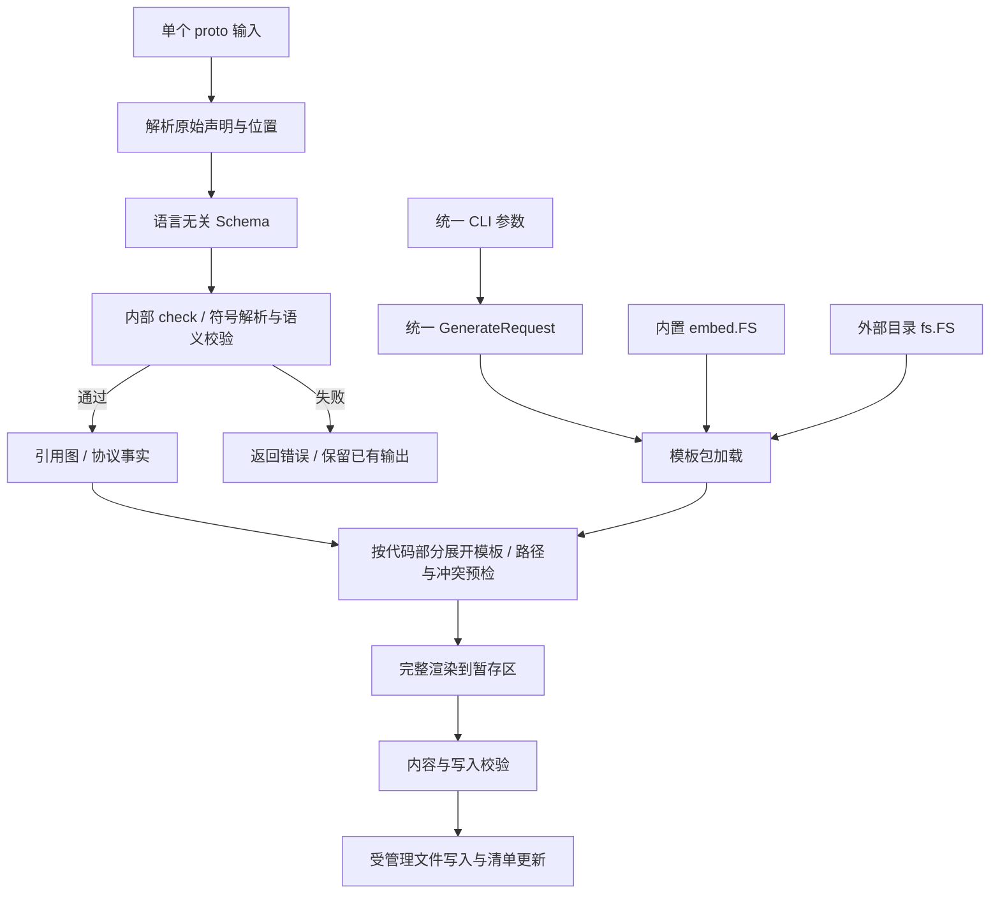

# BaoHuLu 语言无关代码生成架构改造规划

> 状态：待审核，尚未开始实施。本文中的 TODO 均为后续工作。
>
> 规划日期：2026-09-11。代码基线：`8d360aa445785f24d26bdb1047aa8fe82eb23020`。
>
> 需求依据：[2026-09-11_merge_go_csharp.md](../doc/prompts/2026-09-11_merge_go_csharp.md)。本次上下文没有提供编辑器当前文件路径；根据当天新增文件及其内容，将这份文件识别为本次改造提示词。若所指文件不同，应先调整需求基线。
>
> 本轮规划文件位于 `doc/prompts/`，包含本文及 `golang_tpl_config.yaml`、`csharp_tpl_config.yaml` 两份模板配置草案。不修改生成器、模板、运行库、示例或现有生成产物。
>
> 2026-09-27 修订：按用户要求，将原 `hulu.json` 方案简化为 YAML 的“代码部分 → 模板文件”映射；尚未开始实现。
>
> 2026-10-02 修订：编解码模板按 From / To 两个方向组织，相关变体、大小计算及辅助方法并入对应模板和生成文件，不再每个方法单独配置。
>
> 2026-10-06 修订：按 proto 声明类型选择模板；enum 只应用对应的 enum 模板，message 应用多个已配置且启用的 message 相关模板。
>
> 2026-10-08 修订：新版命令行统一使用模板包和输出目录参数，不再提供 Go/C# 各自独立的参数；旧语言专属参数改为迁移说明，不进入最终接口。
>
> 2026-10-09 修订：移除 `-with.test`、`-with.bench`、`-with.project`；是否生成测试、benchmark 和项目文件改由 proto 文件级 extension 声明；移除 `-dry-run`，不提供只预检而不写入的模式；移除 `-types.manifest`，不支持跨生成任务的类型符号清单。
>
> 2026-10-11 修订：已有 `.tpl` 只按类型声明和函数实现边界机械拆成多个模板文件，不修改模板正文的实现；任何确实需要改写模板内部逻辑的事项必须脱离拆分任务单独提出并审核。
>
> 2026-10-11 extension 修订：`@test`、`@bench`、`@project` 分别改名为 `@gen_test_code=on/off`、`@gen_benchmark_code=on/off`、`@gen_project_file=on/off`；默认值依次为 `off`、`off`、`on`。
>
> 2026-10-11 CLI 修订：移除 `check`、`generate` 子命令及 `xi`、`tu` 旧别名；直接执行 `hulu` 并传入参数即进入生成流程，内部先执行一次 check，通过后再生成。

## 命令行参数总览

本节是新版 CLI 的完整参数清单，实施时以此为准。命令行只描述“输入 proto、使用哪个模板包、输出到哪里”，不接收 `-language`，也不承载测试、benchmark、项目文件等代码部分开关。目标语言及生成规则完全由 `-template.dir` 所选模板包的 `tpl_config.yaml` 和 proto 文件级 extensions 决定。

除帮助与版本查询外，每次执行 `hulu` 都进入生成流程：参数校验通过后，内部先解析 proto 并执行一次 check（语法、引用及语义校验），通过后才展开输出计划、渲染和写入。check 失败时返回错误并保留已有输出；不提供独立校验命令或跳过校验的开关。

| 命令或参数 | 作用 | 取值、默认值与调整方式 |
| --- | --- | --- |
| `hulu help`、`hulu -h`、`hulu -help`、`hulu --help` | 显示总帮助 | 保留现有入口；帮助中列出统一参数和旧参数迁移提示 |
| `hulu --version` | 显示版本 | 保持现有行为 |
| `hulu <参数>` | 内部先 check，通过后使用一个模板包生成一个目标 | 无需操作子命令；一次调用只接受一个 `-src`、一个 `-template.dir` 和一个 `-out` |
| `-src=<file>` | 指定输入 `.proto` 文件 | 生成必填；沿用现有参数名，不做语言区分 |
| `-template.dir=<bundle>` | 指定模板包 | 生成必填；可为外部目录，或 `builtin:<包名>` 形式的内置模板包；目录内必须有 `tpl_config.yaml`。当前内置包名可为 `golang`、`csharp`、`csharp/QiWa.rpc`，但 CLI 只按统一模板包协议加载，不分支处理语言 |
| `-out=<dir>` | 指定本次生成的输出根目录 | 生成必填；替代 `-go_out`、`-csharp_out` 和 `-dst.csharp_template.out_dir` |

旧操作子命令和语言专属参数不在新版中继续解析或暗中转译；若检测到这些名称，应在报错中给出以下确定的替换方式：

| 旧用法 | 新版调整方式 |
| --- | --- |
| `hulu generate ...`、`hulu tu ...` | 删除操作子命令，改为 `hulu -src=<file> -template.dir=<bundle> -out=<dir>` |
| `hulu check ...`、`hulu xi ...` | 独立校验命令已移除，无仅校验的等价入口；生成时内部自动校验，旧调用报错且不自动转为生成 |
| `-go_out=<dir>` | 改为 `-template.dir=builtin:golang -out=<dir>`；使用外部模板时把前者改为对应目录 |
| `-csharp_out=<dir>` | 改为 `-template.dir=builtin:csharp -out=<dir>`；使用外部模板时把前者改为对应目录 |
| `-go_out.with.test`、`-csharp_out.with.test` | 删除命令行参数，在 proto 文件头加入 `// @gen_test_code=on` |
| `-go_out.with.bench`、`-csharp_out.with.bench` | 删除命令行参数，在 proto 文件头加入 `// @gen_benchmark_code=on` |
| `-src.csharp_template.dir=<dir>` | 改为 `-template.dir=<dir>`；同一参数适用于数据、RPC 和第三方模板包 |
| `-dst.csharp_template.out_dir=<dir>` | 改为 `-out=<dir>` |
| 旧命令默认生成 `go.mod`、`.csproj` 等项目文件 | 无需增加 extension；`@gen_project_file` 默认是 `on`，需要显式写出时使用 `// @gen_project_file=on` |
| `-no.csproj.file` | 删除命令行参数，在 proto 文件头加入 `// @gen_project_file=off`；新版会关闭所选模板包的整个 `project` 部分，不再保留旧参数只跳过 C# 主项目的特殊语义 |
| 同一命令同时使用 `-go_out` 和 `-csharp_out` | 拆成两次 `hulu` 调用，每次选择一个模板包和一个输出目录；两次调用使用完全相同的参数名称 |

因此，新版生成命令只有一套形态：`hulu -src=<file> -template.dir=<bundle> -out=<dir>`。添加第三种语言时只增加模板包，不增加新的命令行参数。

测试、benchmark 和项目文件生成使用现有注释式 extension 体系新增以下文件级开关：

```protobuf
// @gen_test_code=on
// @gen_benchmark_code=on
// @gen_project_file=on
syntax = "proto3";

package demo;
```

- 三个 extension 必须写在文件头注释中、位于 `syntax` 之前；名称沿用现有 extension 规则且不区分大小写，值只能是小写 `on` 或 `off`，每个名称在同一文件中最多出现一次。缺少值、使用其他值或重复声明均报错。
- `@gen_test_code` 默认 `off`。有效值为 `on` 时，对当前 proto 中所有未废弃 message 展开模板包的 `tests` 映射；值为 `off` 或未声明时不生成测试。
- `@gen_benchmark_code` 默认 `off`。有效值为 `on` 时展开 `benchmarks` 映射；值为 `off` 或未声明时不生成 benchmark。测试和 benchmark 各自按配置生成一次共享辅助文件，互不隐式启用。
- `@gen_project_file` 默认 `on`。有效值为 `on` 或未声明时展开模板包已有的 `project` 映射，主项目文件按任务生成一次；测试、benchmark 的项目文件还分别要求 `@gen_test_code=on`、`@gen_benchmark_code=on`。项目文件开关不会反向启用测试或 benchmark 源码。
- 本文所称“项目文件”，在 C# 模板包中指 `.csproj` 文件，在 Golang 模板包中指 `go.mod` 文件；它们统一由 `@gen_project_file` 控制。
- 要改变行为必须显式写 `on` 或 `off`；删除 extension 会恢复对应默认值，因此删除 `@gen_test_code=on`、`@gen_benchmark_code=on` 会关闭相应代码，而删除 `@gen_project_file=off` 会重新启用项目文件。这些文件级 extension 都不向 import 或 external 引用的 proto 传播。
- proto 显式声明某项为 `on`、但所选模板包没有对应的 `tests`、`benchmarks` 或 `project` 映射时，在输出计划阶段明确报错，不能静默忽略。自定义模板包没有 `project` 映射且 proto 未显式写 `@gen_project_file=on` 时，默认 `on` 只表示“生成模板包提供的项目文件”，不把缺失的可选映射视为错误。
- `@gen_project_file=off` 后不再创建项目文件，但已经存在的 create-only 项目文件按写入保护规则保留并报告。

新版不提供 `-dry-run` 或其他等价预览模式。生成流程在内部 check 通过后，仍须在写入前完成输出计划、路径冲突、模板渲染和文件归属检查，但全部检查通过后即提交写入；需要审阅差异时应生成到新目录或使用版本控制比较。

新版也不提供 `-types.manifest`、`.hulu-types.json` 或其他跨生成任务的类型符号清单。RPC 等模板只能使用当前 `-src` 解析得到的 Schema、proto options 和模板包自身的命名规则；工具不读取既有生成目录来发现类型，也不校验另一个模板包实际生成的语言符号。

## 1. 建议审核的核心结论

建议把项目改造成一条统一流水线：**解析 proto → 建立语言无关模型 → 内部 check（引用解析及语义校验）→ 分析引用与协议事实 → 加载模板包 → 计算输出清单 → 渲染全部内容 → 校验并写入**。

Go 和 C# 的差异应由各自模板包表达，包括类型表示、命名、指针或 Wrapper 策略、方法实现、项目依赖及测试数据。Go 实现负责协议分析和通用模板机制，不再分别维护 Go/C# 两套生成前处理。

这次改造同时涉及“架构替换”和“生成文件布局改变”。应先固定现有行为和测试基线，再逐步接入新引擎，最后切换默认入口并移除旧实现。不能把“模板已经搬到根目录”视为完成，也不能仅验证 Demo 生成成功就删除旧生成器。

### 1.1 需要审核的设计决策

以下是具体建议，不表示已经获得实施许可。可以按编号批注；批准整份规划时，应一并确认这些兼容性选择。

| 编号 | 建议采用的方案 | 影响与取舍 |
| --- | --- | --- |
| D01 | 用一个中立模型和一个生成引擎；禁止在新核心中出现按 Go/C# 分支的类型映射、源码拼接和前处理 | 第三种语言通过模板包接入；迁移成本较高，但符合需求本意 |
| D02 | 用一份 YAML 配置列出 message、JSON、Protobuf 等代码部分对应的 `.tpl` 文件 | 配置值直接是模板路径；不引入输出 ID、scope、group、when、requires 等调度字段 |
| D03 | 语言规则放入输出模板和 `partials/` 公共子模板，使用统一上下文 | 不增加 JSON 准备模板和中间数据配置；复杂映射先通过 P3 小规模原型验证 |
| D04 | 在 `templates/embed.go` 建立纯资源包，嵌入 `golang/`、`csharp/`；不必在仓库根目录增加 Go 包 | 内置和外部目录使用同一 `fs.FS` 加载路径；避免 `go:embed ../...` 问题 |
| D05 | `AllTypes.go/.cs` 放写类型与读类型的声明；每种序列化格式按 From / To 各用一个模板并生成一个文件，相关变体及辅助方法合并；写类型和读类型的 Reset 共用一个模板及生成文件 | 按最新要求简化模板和输出文件数量；方法签名、类型名称和协议行为尽量保持 |
| D06 | 最终 CLI 直接使用 `hulu` 加通用参数生成；移除 `generate`、`check` 子命令、`tu`、`xi` 旧别名及 Go/C# 专属参数，并提供明确迁移诊断 | 接入第三种语言无需修改 CLI；旧生成命令需要按本页顶部映射调整，独立校验入口取消 |
| D07 | 默认生成类型和现有序列化方法；YAML/URL Values 保持注解及传递依赖规则；测试和 benchmark 分别由默认 `off` 的 `@gen_test_code`、`@gen_benchmark_code` 控制，项目文件由默认 `on` 的 `@gen_project_file` 控制，RPC 由独立模板包启用 | 纯序列化用户默认不生成测试和 benchmark；模板包提供项目映射时默认生成项目文件，可显式关闭 |
| D08 | 先支持一个明确的模板包目录，不做隐式模板覆盖、远程模板仓库或自动下载 | 模板来源可预测；定制通过复制模板包修改，避免首版复杂继承规则 |
| D09 | 新版用生成清单管理文件；不自动删除未归属的旧文件或人工文件；首次迁移优先生成到新目录 | 需要明确的首次迁移步骤，防止新旧类型同时参与编译及业务代码丢失 |
| D10 | 每次生成都必须先执行一次内部 check，复用解析得到的 Schema 完成引用和语义校验；校验通过后才生成，不支持的语法在生成前明确报错 | 校验失败时不渲染、不写入；对过去“被解析但被静默忽略”的输入属于行为收紧，需写入迁移说明 |
| D11 | 不顺带实现完整 import、多文件输入、oneof、optional、stream；保留现有单文件及外部同包类型引用能力 | 把大改限制在生成架构；中立模型预留引用信息，但不宣称新增完整 protobuf 支持 |
| D12 | RPC 阶段完成新模板协议和已有服务端模板迁移；未完成的客户端保持实验性质 | 不把完整客户端、重试、连接池和服务发现纳入主重构验收 |
| D13 | 性能门槛以同机、同工具链的新旧实测为准；建议关键场景中位数退化不超过 5%，既有零分配场景不增加分配 | 数值是待审核阈值；噪声或超阈值必须解释，不能用历史 README 数字代替基线 |
| D14 | 用默认 `on` 的文件级 `@gen_project_file` 控制模板配置中的整个 `project` 部分，不保留 `-no.csproj.file` 的 C# 特例 | `@gen_project_file=off` 时不生成任何新项目脚手架；范围比旧参数明确且一致，这是需要写入迁移说明的行为变化 |
| D15 | Service 保存有序 Methods 及去重的直接引用类型；service 模板每个 service 执行一次，rpc 模板每个 method 执行一次，统一传 `RenderContext` | service 模板可处理多个 method/message；Go 核心只解析引用和重绑定上下文，不生成语言类型名，细节按第 6.2.1 节后续 review |
| D16 | 已有 `.tpl` 的迁移只改变文件边界：按类型声明和函数实现区块机械拆分，不改模板正文实现 | 不在拆分中重构条件、表达式、生成语句或算法；若新上下文无法兼容原正文，先暂停并把必要改动作为独立决定审核 |

### 1.2 最终完成标准

- 任意一个受支持的 proto，指定模板包目录和输出目录即可生成；无需新增语言 Go 包、修改核心 `switch` 或重新编译二进制来接入外部模板包。
- 直接执行 `hulu` 加参数即生成；内部 check 必须先通过，失败时已有输出保持不变；没有独立的校验或生成操作子命令。
- 内置 Go/C# 生成与自定义模板生成走同一条流水线，模型中不再保存 `GoType`、`MapKeyCS`、`EffWriterType` 等语言结果。
- 所有 message 的类型声明按类型独立，写类型和读类型同文件；各格式编解码按 From / To 拆分，生命周期方法按约定拆分。
- 已有 `.tpl` 拆分前后的模板实现区块保持一致；除独立文件边界所需的外层包装外，评审 diff 不包含模板正文改写。
- 现有类型、编解码 API、扩展注解、测试及 benchmark 能力完成迁移；有意改变的行为有清单及测试。
- 默认不生成 RPC；需要时可显式选择 RPC 模板包，引用同一批生成类型。
- 小型边界 fixtures、完整 Demo、新旧对比、生成产物编译及性能门槛通过后，才删除旧生成器。

### 1.3 提示词要求与执行阶段对应

| 提示词要求 | 设计位置 | 实施阶段 |
| --- | --- | --- |
| 根目录统一模板，并兼容 embed | 第 4、6 节 | P2，P4，P5 |
| 一套 proto 数据结构，Go 不分别处理两种语言 | 第 5、6 节 | P1，P3，P8 清理 |
| 语言规则迁入 `.tpl`，极少量 util 才作为例外 | 第 6.3–6.5 节 | P3 原型，P4/P5 全量迁移 |
| 每个 message 的写/读类型放在独立类型文件 | 第 7 节 | P4，P5 |
| 编解码按 From / To 分模板和文件，包含相关变体及辅助方法 | 第 7.1–7.3 节 | P3 验证，P4/P5 覆盖全部方法 |
| 已有 `.tpl` 只按类型/函数边界拆分，不修改内部 template 实现 | 第 6.1.1、7.1 节 | P0 冻结区块，P2/P4/P5 机械拆分并对照 |
| 类型/方法/测试/benchmark 模板规范 | 第 6、7 节 | P2/P3 冻结，P4/P5 实现 |
| service 多 method 涉及多个 message 时的模板输入 | 第 6.2.1、9 节 | P2 上下文，P3 原型，P7 迁移 |
| proto + 模板目录即可生成 | 第 8.1 节 | P2，P3，P6 |
| RPC 可选，基于当前 Schema 和模板命名约定引用数据类型 | 第 9 节 | P6 统一入口，P7 正式迁移 |

## 2. 当前项目的实际状况

以下来自当前源码审阅，不能用它们推断尚未运行的端到端测试已经通过。

### 2.1 模块与耦合点

| 位置 | 现有职责 | 改造含义 |
| --- | --- | --- |
| `cmd/hulu/main.go`，539 行 | CLI、Go/C# 分流、创建文件、项目文件、RPC 文件名替换、benchmark proto 改写 | 入口必须减为参数解析和调用；不能只合并两个内部目录 |
| `internal/protofile/protofile.go`，669 行 | proto 收集、类型表、注解、递归分析、Go 命名/类型映射、64 位布局估算 | 已有共享层，但不是语言无关层；需拆开事实和语言表示 |
| `internal/golang/golang.go`，2,418 行 | Go 模板数据、imports 条件、布局、literal、代码片段、测试/benchmark、YAML/URL 闭包 | 大量内容必须迁入模板或变成真正通用的算法 |
| `internal/csharp/csharp.go`，1,211 行 | C# 字段类型、Wrapper、模板数据、测试/benchmark、YAML/URL 闭包 | 与 Go 有重复，也有不能直接合并的语义差异 |
| `internal/protocheck` | 独立解析和部分语义限制 | `generate` 当前未调用这套检查；统一时要明确行为改变 |
| `internal/protoextensions` | 注解提取与清理；含带行号/不带行号的重复实现 | 保留原始注解和来源位置，统一扩展解释 |
| `internal/*/templates` | 已有大部分编解码实现 | 两个主模板分别为 3,137 行 Go、1,691 行 C#；迁移需要细分验证 |
| `internal/golang/go_mod.go`、C# 三个项目辅助文件 | 用 `fmt.Sprintf`、字符串替换组装项目文件 | `.tpl` 后缀目前不等于统一使用 `text/template`，这些也要转换 |
| `templates/csharp/QiWa.rpc` | 已存在的外部 RPC 模板及客户端草稿 | 根目录 `templates/` 不是空目录，搬迁时必须保留现有内容 |
| `dependencies/golang` | 生成代码的 fastjson、fastfloat、utils 运行时依赖 | 本次默认保留目录和公开 import path，不能随生成器一起搬走 |

### 2.2 当前产物布局

Go 主路径把一个 proto 的所有 message/enum 输出为 `demo.go`，测试为 `demo_test.go`，benchmark 为 `demo_timing_test.go`，比较测试为 `demo_compare_test.go`。YAML 和 URL Values 已有按 message 分文件的局部实现，但一个文件通常同时容纳编码和解码方法。

C# 主路径已经按写类型和读类型分别输出，例如 `Demo.AllTypes.cs`、`Demo.ReadonlyAllTypes.cs`，另有枚举文件、YAML/URL Values 文件、`Tests/`、`Benchmarks/` 及 `Benchmarks/GrpcGen/`。它与目标“同一个类型文件容纳 AllTypes 和 ReadonlyAllTypes，然后按方法拆分”仍然不同。

`build/golang/DemoServer` 和 `build/csharp/QiWa.rpc` 是本地存在的产物，并非可信的唯一基线。例如现有 Go 产物的 `go.mod` 写着 `v0.15.0+dirty`，当前源码 Makefile 版本为 `v0.16.0`；现有 QiWa 项目还有模板默认项目未声明的框架依赖。后续必须从固定源码重新生成基线。

### 2.3 必须在规划中处理的事实与风险

1. **语言泄漏已进入模型。** `FieldDef.GoType`、`ScalarProtoToGo`、`ProtoTypeToGo` 和 Go 布局函数位于公共解析包；C# 调用 `ProtoTypeToGo` 判断 map 值类型，也使用 Go 尺寸规则排序。
2. **类型解析依赖遍历时机。** `CollectMessage` 收集字段时就判断 enum/message；后定义的 enum 存在被错判为 message 的风险。需用先收集符号、后解析引用消除这一结构性问题，并单独记录结果差异。
3. **声明顺序不等于依赖顺序。** Go 渲染函数假定 `Order` 总是依赖在前，但 Demo 的 `AllTypes` 就在它引用的 `ValueTypes` 之前。布局缓存不能继续依赖这个假设。
4. **枚举输出顺序不稳定。** `EnumOrder()` 遍历 map，没有排序；不能把旧文件字节顺序当作唯一正确标准。
5. **两种递归问题不同。** 普通字段形成的值嵌入环决定指针/Wrapper；包含 repeated 和 map 的全引用图决定测试数据构造是否无限递归。不能只保留一个 `IsRecursive` 布尔值。
6. **YAML 和 URL Values 传播规则不同。** YAML 跟随普通、repeated、map-value message 引用；URL Values 当前只跟随普通/repeated message，map value 走 JSON 路径。应保留该区别。
7. **外部引用是有意支持的弱引用。** 当前未定义 message 引用会告警，假定另一次生成提供该类型，不再伪造空类型。新分析不能把它误当 deprecated 类型删除，也不能对其查表后直接解引用。
8. **模板文档与实现有差距。** `@formName` 有文档和 Demo 注释，但字段扩展解析没有保存它；RPC 实际解析的是多个 `@path`，README 中的 `@method` 并未实现。未知注解目前还会被剥除。
9. **Demo 不是真正穷举。** decimal、bool map key 当前被注释掉；前向 enum、互递归、同名 service method、空 message、多 proto 同包输出等仍需独立 fixtures。
10. **生命周期行为必须看代码。** Go 模板含 `strArena`、parser、`FromProtobufWithArena`、Clone 对齐及 map/repeated 复用；README 的部分 `WithCopy` 描述与当前模板 API 不一致。迁移基线以当前可运行实现为准。
11. **C# Wrapper 是公开生成类型。** 当前主模板实际输出每个 message 的 writer/readonly Wrapper，不能因为 `NeedsWrapper` 看起来可用于优化，就顺手删除“没用到”的公开类型。
12. **辅助代码会发生重名。** Go YAML 注释常量包含仅按行号构造的名字；多个 proto 同包会碰撞。C# 测试和 benchmark 含公共辅助类，机械拆分会重复定义。
13. **benchmark 依赖不是普通测试依赖。** Go benchmark 用到 sonic 和 `encoding/json/v2`，比较测试还依赖 benchmark builder；`GoModContent` 当前只根据 `withTest` 添加 sonic，bench-only 组合需要单独验证。
14. **旧 RPC 模板有示例耦合。** `MethodContext__rename.cs.tpl` 直接写 `rsp.Code`、`rsp.Message`，并不适用于任意 response。`Method.Client__rename.cs` 不是 `.tpl`，当前目录加载器不会渲染它，且文件仍是开发草稿。
15. **项目文件并非都可无条件重写。** 现有 `.gitignore` 采取“存在则保留”；`-no.csproj.file` 只保护主项目生成；RPC `__rename` 文件没有实际的防覆盖机制。

### 2.4 本次实际完成的轻量核查

| 核查 | 结果 |
| --- | --- |
| 仓库及父目录适用 `AGENTS.md` | 未发现 |
| 工作区初始状态 | 只有未跟踪的 `doc/prompts/`，未改动已有文件 |
| `go test ./internal/... ./cmd/hulu/... ./dependencies/golang/...` | 通过；生成器、检查器、解析器、扩展解析包均显示 `[no test files]`；utils 与 fastfloat 的已有测试通过 |
| 本机工具链 | Go `go1.27.0 darwin/arm64`，.NET SDK `10.0.101`；`protoc` 与 `buf` 可找到 |
| 项目声明工具链 | 根 `go.mod` 为 Go 1.23；C# 项目模板为 `net10.0`；声明版本与本机可用版本需分开验证 |
| `go list ./...` | 会枚举部分 `build/` 下包；不会覆盖其中独立 `go.mod` 模块的全部测试 |
| `make -n test` | `run` 虽被列入 `.PHONY`，没有实际生成步骤，展开后只运行根 `go test ./...` 和 coverage |
| 完整生成产物编译、C# 测试、新旧性能对比 | 本轮未执行，列为实施前基线任务 |

## 3. 范围与兼容性边界

### 3.1 本次必须完成

- 统一 proto 模型、引用分析、模板上下文和生成入口。
- 根目录模板包组织、内置 embed、外部模板目录生成。
- Go/C# 的类型、方法、YAML/URL Values、测试、benchmark、项目文件迁移。
- 统一 CLI、旧参数迁移诊断、帮助信息、写入前的完整冲突检查和输出清单管理。
- RPC 扩展协议和已有服务端模板的迁移、纯数据类型引用方式。
- 生成文件归属、重名检测、失败保护、首次旧产物迁移说明。
- 行为/兼容性/性能验收、文档和可复现的测试入口。

### 3.2 不随本次主重构扩张

- 完整跨文件 import 解析、目录批量输入、跨 namespace 自动依赖管理。
- oneof、optional presence、proto2 required、streaming RPC、新协议格式。
- Rust/Java/TypeScript 等完整生产级后端；只增加一个极简验证模板，证明引擎不绑定两种语言。
- RPC 客户端产品化、网络连接管理、自动重试、服务发现、框架功能增强。
- 修改运行时库 import path、重做 arena/内存池、替换 fastjson、推广新的序列化算法。
- 模板远程下载、插件市场、执行任意 shell 的模板 hook、复杂模板继承。
- 跨生成任务的类型符号清单、既有源码扫描、任意数据模板包与 RPC 模板包的自动符号对接。
- 修复所有 `doc/TODO.md` 历史事项。必要修复按下面的分类逐项记录。

### 3.3 兼容性分级

| 维度 | 目标 | 允许的差异 |
| --- | --- | --- |
| 命令行 | 直接执行 `hulu -src=<file> -template.dir=<bundle> -out=<dir>`，内部先 check 再生成 | `tu/generate`、`xi/check` 操作子命令及 Go/C# 专属参数移除；按本页顶部映射迁移，输出文件布局按新规范改变 |
| 可选代码生成触发 | 用 proto 文件级 `@gen_test_code=on/off`、`@gen_benchmark_code=on/off`、`@gen_project_file=on/off` 作为各自唯一开关，对所有模板包采用相同规则；默认值分别为 `off`、`off`、`on` | 旧测试/benchmark/项目命令行参数移除；把测试/benchmark 从 `on` 改为 `off` 时对应 managed 文件会被 prune，把项目从 `on` 改为 `off` 时已有 create-only 项目文件保留 |
| 生成代码公开 API | 保持类型名、字段名/类型、可见性、方法签名、接口、Wrapper | 用户批准的命名修复另列，不与搬迁混合 |
| Protobuf | 保持已支持类型的 wire 语义和双向可读性 | 字段序、map entry 序不必字节相同；不得改变 wire type 来换性能 |
| JSON | 保持当前名称、数字、bytes、wrapper、null 等语义 | 不强行切换成官方 ProtoJSON；不要把两者差异判为本次回归 |
| YAML/URL Values | 保持当前编码约定、注解触发及传播 | 注释符号名等内部重命名可以变化；输出语义变化单列 |
| 输出文件名 | 明确为 breaking change | 通过新目录迁移和产物清单避免新旧文件重复定义 |
| 模板上下文 API | 新版从 v1 起建立契约 | 旧外部 RPC 模板先走兼容适配；不能声称与新上下文天然兼容 |
| 运行时依赖 | 保留 Go 公开路径及 C# 必需依赖 | 测试环境锁定具体版本；不在本次顺便升级依赖 |

对审阅中发现的问题分三类：A 类是迁移后仍应保持的有效行为；B 类是新架构必须解决的结构问题，如前向符号解析、输出重名和半成品写入；C 类是可独立处理的功能/性能修复，如真正实现 `@formName` 或重新优化 C# 布局。B 类必须附回归测试和变更说明；C 类不自动并入主线。

## 4. 目标架构与目录

### 4.1 数据流



推荐边界：`protofile` 负责读入，`schema` 负责中立数据与分析，`codegen` 负责模板执行和产物管理，CLI 负责装配。不要为每个小功能创建独立 Go 包；下面各职责可以先在少数文件中实现，规模增长后再拆。

### 4.2 建议的最终目录

```text
cmd/hulu/
  main.go                       # 参数解析、帮助/版本、统一生成入口
  generate.go                   # GenerateRequest -> 内部 check -> 生成
  compat.go                     # 旧 RPC 模板上下文的限期适配
internal/
  protofile/
    parse.go                    # AST -> Schema，无目标语言映射
  protoextensions/
    extensions.go               # 注解解析、原始值及位置
  protocheck/
    protocheck.go               # 内部 check 的薄入口，复用 schema 校验，无独立命令
  schema/
    schema.go                   # File/Message/Field/Enum/Service/RPC/TypeRef
    resolve.go                  # 分两遍解析引用
    validate.go                 # 支持范围与语义校验
    graph.go                    # 带边类型的引用图、环与闭包
    wire.go                     # wire type、tag、packability 等协议事实
  codegen/
    request.go                  # 请求与生成结果
    bundle.go                   # YAML 模板映射、fs.FS、配置验证
    context.go                  # 所有模板使用的统一上下文
    funcs.go                    # 少量无语言语义的函数
    layout.go                   # 显式布局描述输入 -> 顺序/尺寸
    plan.go                     # 按类型和方法展开输出、路径冲突
    render.go                   # 模板解析缓存和执行
    write.go                    # 文件归属、暂存、提交和恢复
  integration/                  # 跨模块编译及行为验证
templates/
  embed.go                      # 仅嵌入资源，不反向依赖 internal/codegen
  README.md                     # 模板作者入口
  golang/
    tpl_config.yaml             # 实施时由 golang_tpl_config.yaml 草案迁入
    partials/                   # 命名、类型、字段、literal、布局描述
    types/                      # message/enum/type support
    methods/                    # 各格式 From / To 模板及生命周期模板
    tests/
    benchmarks/
    project/
  csharp/
    tpl_config.yaml             # 实施时由 csharp_tpl_config.yaml 草案迁入
    partials/
    types/
    methods/
    tests/
    benchmarks/
    project/
    QiWa.rpc/                   # 独立模板目录，须显式选择
      tpl_config.yaml           # 同样采用“代码部分 → 模板文件”映射
      service/
      method/
      project/
testdata/
  proto/                        # 小而明确的类型/注解/错误 fixtures
  bundles/                      # 最小第三模板包及错误模板
  golden/                       # 少量人工可读预期，不提交全部 Demo 巨量产物
  compatibility/                # 协议向量与 API 基线
scripts/                        # 按实际需要添加集成测试入口
dependencies/golang/            # 保留运行时公开路径
examples/DemoServer/proto/      # 保留原有 Demo
doc/
  TemplateSpec.md
  Migration.md
  Architecture.md
  prompts/
    plan.md
    golang_tpl_config.yaml
    csharp_tpl_config.yaml
```

`internal/golang`、`internal/csharp` 只在迁移期间保留，最终删除。为接入旧模型而增加的临时适配器必须注明删除阶段，不得演变为永久后端。

### 4.3 embed 的具体方案

`templates/embed.go` 的包名可为 `templates` 或 `builtintemplates`，仅导出资源 `FS`。构建时用正确的 `//go:embed` 指令嵌入模板树，由 CLI 把相应子树交给 `codegen`；外部目录用同样的接口。

Go 的 embed 路径相对声明文件所在包，不能使用 `..`；命名以下划线或点开头的资源还涉及匹配规则。建议模板目录使用 `partials/`，需要完整嵌入隐藏资源时明确使用 `all:`，并测试内置与外部加载文件清单一致。[Go embed 官方说明](https://pkg.go.dev/embed)

不需要把某个用户电脑上的模板绝对路径编译进程序。运行内置模板时也不应依赖当前工作目录能找到仓库的 `templates/`。

## 5. 中立模型：统一事实，不统一语言表示

### 5.1 模型应保存什么

| 对象 | 应保存的事实 |
| --- | --- |
| File/Schema | 源文件名与内容标识、syntax、proto package、文件级 options 与 extensions（包括 `@gen_test_code`、`@gen_benchmark_code`、`@gen_project_file` 的显式值和生效值）、声明顺序、imports 原文及诊断 |
| Message | 原始名称、作用域/完整符号标识、注释与位置、字段、扩展、是否被 deprecated |
| Field | 原始字段名、编号、原始类型引用、singular/repeated/map、map key/value 引用、options、扩展及注释 |
| TypeRef | scalar/enum/message/external 分类、原始引用字符串、目标符号 ID、是否已解析 |
| Enum | 名称、值及声明顺序；别名等语义按明确支持范围处理 |
| Service/RPC | Service 的 methods（声明顺序）及直接引用类型集合；RPC 的原始名称、所属 service、请求/响应 TypeRef、多个 path、注释与位置、stream 标记 |
| Annotation | 原始 key/value/位置；已识别扩展的结构化值；未知注解可供外部模板读取 |
| Analysis | 值嵌入环、全引用环、入边信息、依赖关系、协议 wire 信息、确定性顺序 |

`go_package`、`csharp_namespace` 是 proto 文件里的原始 options，允许保存在中立模型中。禁止的是解析层把它们加工成最终 Go package、C# namespace、字段类型字符串或源码片段。

保留原始名字与 `@VarName` 等覆盖值，不在解析时覆写原始字段名。这样可同时检查 proto 名称冲突、生成语言名称冲突和 JSON/YAML 名称冲突，诊断还能指回准确位置。

### 5.2 分析顺序

1. 解析 AST，收集全部声明、注解和来源位置。
2. 构建符号索引，识别重复声明；保存源顺序。
3. 解析字段、map 值及 RPC 的引用，不依赖声明先后。
4. 应用明确的 deprecated 规则；保存被过滤原因；RPC 引用被删除类型时给出明确错误。
5. 校验字段编号、支持范围、扩展组合及名称冲突。
6. 在有效声明上构建引用图，分别计算值嵌入环和全引用环。
7. 计算 protobuf 事实及已有 YAML/URL Values 注解要求的引用闭包。
8. 冻结模型；每个目标独立执行模板，不能修改共享 Schema。

源声明顺序、依赖计算顺序、布局顺序、协议字段输出顺序应是四个明确概念。布局算法需要依赖顺序，并不意味着所有产物都必须改成依赖排序。

### 5.3 不把现有差异藏进统一结构体

以下属于模板包决定的目标表示：

- Go 的 `map[K]*T`、`[]ReadonlyT`、递归 `*T`、`decimal.Decimal`、导出字段名及 struct tag。
- C# 的 `Dictionary<K,TWrapper>`、递归 Wrapper、`decimal`、`JsonPropertyName` 与 `partial struct`。
- Go reader 中的 parser、arena、rawBufferLen、辅助数组，及 C# Wrapper 类。
- `utils.ReadInt32`、C# TryRead 调用、错误返回语句、测试 literal、benchmark 填充循环。

不能创建一个同时含 `GoType` 和 `CsType` 的“统一 Field”，也不能把旧生成器改名为 `prepareGo` / `prepareCSharp` 后继续存在。

## 6. 模板包规范 v1

### 6.1 配置只回答“哪部分代码使用哪个模板”

完整草案见 [Go 配置](golang_tpl_config.yaml) 和 [C# 配置](csharp_tpl_config.yaml)。当前文件放在 `doc/prompts/` 供讨论；实施后，各自放入模板目录并统一命名为 `tpl_config.yaml`。配置中的模板路径相对于所选模板目录，不相对于当前草案文件。

```yaml
message: types/message.go.tpl
enum: types/enum.go.tpl

json:
  FromJSON: methods/FromJSON.go.tpl
  ToJSON: methods/ToJSON.go.tpl

protobuf:
  FromProtobuf: methods/FromProtobuf.go.tpl
  ToProtobuf: methods/ToProtobuf.go.tpl
```

这里只有代码部分和模板路径。JSON、Protobuf、YAML、URL Values 各自只配置 From 和 To 两个模板，一个模板包含该方向的全部相关方法。例如 `FromProtobufWithArena` 并入 `FromProtobuf`，`ToProtobufByAppend`、`ToProtobufVT`、`ProtobufSize`、`marshalToSizedBufferVT` 并入 `ToProtobuf`；JSON 解码辅助方法并入 `FromJSON`。这些方法不再单独配置模板或生成文件。不再配置版本、输出 ID、scope、group、when、requires、writePolicy 或准备阶段。

| 配置项 | 生成内容 |
| --- | --- |
| `message` | 每个 message 的写类型、读类型及相关声明 |
| `enum` | 每个 enum 的声明 |
| `json` / `protobuf` / `yaml` / `url_values` | 各格式的 From / To 模板，包含对应方向的方法变体、大小计算及辅助方法 |
| `lifecycle` | Reset 模板同时生成写类型和读类型的 Reset；Clone 使用独立模板 |
| `tests` / `benchmarks` | 测试、性能测试及相应辅助文件 |
| `project` | 项目文件及 `.gitignore` 等配套文件 |

**类型模板选择规则：生成器在展开输出计划时，必须先区分当前 proto 声明是 enum 还是 message，再选择对应模板。**

- 处理 `enum` 时，只应用配置项 `enum` 对应的模板，每个 enum 执行一次；不为该 enum 应用 `message`、编解码、生命周期或按 `{message}` 展开的测试、benchmark 模板。
- 处理 `message` 时，应用多个与 message 相关的模板：`message` 类型声明模板，以及已配置且启用的 `json`、`protobuf`、`yaml`、`url_values`、`lifecycle` 和按 `{message}` 展开的测试、benchmark 模板；每个适用模板对当前 message 分别执行一次，不应用 `enum` 模板。模板启用遵循 proto extensions、其他注解及引用传播规则，不再由代码部分命令行开关决定。
- message 的字段引用 enum 不改变上述选择：该字段由 message 相关模板处理，enum 声明由对应的 enum 模板独立处理。项目及共享辅助文件仍按任务处理一次，不随每个类型重复执行。

固定约定尽量少：

- `message` 模板对每个 message 执行一次，`enum` 模板对每个 enum 执行一次。扩展名取模板去掉 `.tpl` 后的扩展名，例如 `types/message.go.tpl` 生成 `AllTypes.go`。
- 每个编解码或生命周期模板对每个 message 执行一次，输出为 `类型名.配置键.扩展名`；例如 `json.FromJSON` 生成 `AllTypes.FromJSON.go`，`lifecycle.Reset` 生成 `AllTypes.Reset.go`，其中同时包含写类型和读类型的 Reset。一个文件可包含多个相关方法；新增编解码变体或辅助方法时，直接加入对应 From / To 模板，无需增加配置项。
- `tests`、`benchmarks`、`project` 的文件名差异较大，直接用“输出相对路径 → 模板文件”映射。路径中的 `{message}` 按类型展开，`{file}` 替换为当前 proto 文件名（不含扩展名）；没有 `{message}` 的条目每次任务只处理一次。不使用路径模板表达式。
- 模板是否启用由 proto extension 的生效值决定：`tests` 仅在当前文件 `@gen_test_code=on` 时启用，`benchmarks` 仅在 `@gen_benchmark_code=on` 时启用，`project` 在 `@gen_project_file` 缺省或为 `on` 时启用，YAML/URL Values 保留已有注解及引用传播规则。`project` 中的 `Tests/`、`Benchmarks/` 条目还分别要求测试、benchmark 开关为 `on`。
- 省略某项即不提供该部分；空路径、未知顶层项、重复键和引用不到的模板报错。内置配置必须覆盖现有 API；自定义配置自行保证所选代码完整，不增加通用依赖描述语言。若 proto 显式用 `=on` 请求能力而模板包省略对应的 `tests`、`benchmarks` 或 `project`，按不支持的已请求能力报错；仅由 `@gen_project_file` 的默认 `on` 生效且自定义模板包省略 `project` 时不报错。
- 条件分支写在 `.tpl` 内，例如私有 JSON 数组方法仅在需要时输出；只含空白的渲染结果不生成文件。
- 公共子模板固定放在 `partials/` 下，递归加载其中的 `.tpl`，本身不生成文件；其余模板只加载配置明确引用的文件。模板使用包内相对路径标识，重名的非空 `define` 报错。

普通静态文本也可以放入不含模板表达式的 `.tpl` 文件，通过 `project` 映射生成，无需另设 `copy` 机制。配置使用严格 YAML 解码，模板路径和输出路径仍执行第 8.4 节的边界与冲突检查。代码如何写入和保护已有文件由生成器统一处理，不要求模板作者逐项选择策略。

#### 6.1.1 已有模板只拆文件，不改正文

本次对仓库中已经存在的 `.tpl` 采用机械拆分：只把原模板中的完整类型声明区块和完整函数/方法实现区块移动到第 6.1、7.1 节规定的多个模板文件。From / To 模板需要容纳多个相关函数时，按原有区块整体搬入对应模板；“合并到同一模板文件”只表示文件归属，不表示合并、重写或抽象这些函数的实现。

拆分时必须遵守以下约束：

- 模板正文中的 `if`、`range`、变量绑定、模板调用、表达式、常量、生成源码语句、语句顺序、错误处理、内存复用、注释和有语义的空白裁剪保持不变；不借机格式化、改名、去重、提取公共子模板、调整算法或修复历史问题。
- 只允许在被搬移区块之外增加独立文件所必需的模板 `define`/`end` 包装、调用入口、生成文件头、package/namespace 和 import/usings，以及调整 YAML 路径。上述边界代码不能改变被搬移区块的输出结果。
- 如果一个私有辅助函数只服务于某个公开函数，则可与其完整搬入同一个 From / To 模板；不得把辅助函数正文拆散后重新拼装。普通静态项目模板不属于类型或函数区块，不为追求拆分形式而强拆。
- 新 `RenderContext`、FuncMap 或文件边界若不能在不改正文的前提下承载旧模板，应暂停该项并记录冲突。必要的模板正文修改必须脱离机械拆分提交，说明原因、最小 diff 和行为影响，经过后续 review 后才能实施。
- 原来位于 Go/C# 生成器源码而不在 `.tpl` 中的逻辑，仍可按 D03 新建模板，但必须保持基线输出行为；这类“首次模板化”与“拆分已有 `.tpl`”分别建映射和评审，不得用新建模板掩盖对已有模板正文的重写。

P0 应保存已有模板文件、类型区块和函数区块清单及哈希。迁移评审同时检查“旧区块 → 新文件”映射、区块内容一致性和基线生成结果；忽略获准的文件头/import 边界后，已有模板区块应能逐块对应。发现旧模板 bug 时只登记，不在拆分提交中修复。

### 6.2 统一上下文

**统一输入规则：所有 `.tpl` 文件传入的 struct 类型及字段定义必须一致，统一使用 `RenderContext`，不按目标语言、模板文件或代码部分定义不同的输入 struct。由 template 内部自行决定使用 struct 中的哪些字段以及如何使用；字段值可随当前渲染对象变化。**

`RenderContext` 包含以下字段：

```text
Schema       中立的完整 schema
File         当前输入文件、原始 options 及文件级 extensions（包括 GenTestCode、GenBenchmarkCode、GenProjectFile 的显式值和生效值）
Message      当前 message，非此类输出时为空
Enum         当前 enum
Service      当前 service
RPC          当前 RPC，包含解析后的请求和响应引用
TypeRef      当前需要命名或渲染的类型引用，仅在子模板重绑定后非空
Analysis     图关系、协议事实和能力闭包
Options      规范化后的生成参数
```

上下文不暴露可写文件句柄、整个 `Generator` 对象或带 I/O 副作用的方法。未知配置键和缺失必需字段应明确诊断，而不是输出 `<no value>`。

类型和方法模板可读取当前对象；一次性项目和辅助模板使用完整 Schema。所有模板共享只读模型，不另设需要配置的中间数据层。

#### 6.2.1 Service/RPC 模板输入的暂定决定

本节先冻结一个简单、可实现的 v1 决定，后续 review 可以补字段，但不改变“同一 `RenderContext`、中立对象图、模板负责语言表示”这三个原则。

Go 侧传给模板的中立数据关系暂定如下；这里只表达字段形状，不要求立即按这些 Go 类型名落盘：

```go
type Service struct {
    ID              SymbolID
    Name            string
    FullName        string
    Comments        []Comment
    Methods         []*RPC
    ReferencedTypes []*TypeRef
}

type RPC struct {
    ID              SymbolID
    Name            string
    FullName        string
    Comments        []Comment
    Service         *Service
    Request         *TypeRef
    Response        *TypeRef
    Paths           []string
    ClientStreaming bool
    ServerStreaming bool
}

type TypeRef struct {
    RawName  string
    Kind     TypeKind
    SymbolID SymbolID
    Message  *Message
}
```

- `Service.Methods` 按 proto 声明顺序保存该 service 的全部 method。每个 `RPC.Request`、`RPC.Response` 都是已解析的 TypeRef；本文件内 message 的 `TypeRef.Message` 指向 Schema 中唯一的只读 `Message`，不复制一份 message 数据。external 引用的 `Message` 为空，模板根据 `Kind` 明确处理。
- `Service.ReferencedTypes` 只包含该 service 所有 method 直接使用的 request/response 类型，按 method 顺序及 request→response 顺序首次出现去重。它方便 service 文件生成 imports、注册表或依赖声明；message 字段形成的传递闭包仍从 `Schema`/`Analysis` 查询，不塞进这个列表。
- `service` 映射的模板对每个 service 执行一次：`RenderContext.Service` 非空，`RPC`、`Message`、`Enum`、`TypeRef` 为空。模板通过 `range .Service.Methods` 生成路由表、接口或聚合代码，并从每个 method 的 request/response 引用访问对应 message。
- `rpc` 映射的模板对每个 method 执行一次：`RenderContext.Service` 和 `RenderContext.RPC` 都非空，`Message`、`Enum`、`TypeRef` 为空。模板直接使用 `.RPC.Request.Message`、`.RPC.Response.Message`；不把 request/response message 伪装成当前 `.Message`。
- FuncMap 提供语言无关的 `withRPC(context, rpc)`、`withTypeRef(context, ref)`。前者返回设置当前 RPC 并清空 Message/Enum/TypeRef 的浅拷贝，后者返回设置当前 TypeRef 且保留 Service/RPC 的浅拷贝。这样 service 模板可以复用 rpc/type 命名子模板，同时所有被执行模板仍接收同一种上下文结构。Go 核心不得在这两个函数中计算 Go/C# 类型名、方法签名或源码。

service 模板的基本写法暂定如下：

```gotemplate
{{- $root := . -}}
{{- range $method := .Service.Methods }}
  {{- render "rpc.method" (withRPC $root $method) -}}
{{- end }}

{{- define "rpc.method" -}}
{{ .RPC.Name }}(
  {{- render "type.request" (withTypeRef . .RPC.Request) -}}
) -> {{ render "type.response" (withTypeRef . .RPC.Response) }}
{{- end }}
```

这里的 `type.request`、`type.response` 由模板包定义，负责输出目标语言类型名。若同一个 method 还需要单独文件，则由 `rpc` 映射再次以该 method 的 `RenderContext` 执行，不由 service 模板直接创建文件。Go 生成器只负责执行粒度、引用解析、稳定顺序和上下文重绑定。

### 6.3 怎样把语言逻辑放进 Go template

简单映射直接放在命名子模板，例如 `type.writer`、`type.reader`、`field.name`、`literal.sample`、`proto.read-call`。`render(name, context)` 是通用函数，仅执行已加载的命名模板并返回字符串；Go 代码不判断这个字符串代表哪一种语言。

原生 `text/template` 的模板调用直接写输出，动态复用结果时需要上述小型桥接函数。模板间作用域、空白裁剪、函数错误传播必须按标准库规则设计，并用实际样例验证；不要假定模板支持任意 Go 表达式或函数返回对象。[Go text/template 官方说明](https://pkg.go.dev/text/template)

复杂的类型映射、字段表示和布局描述也由公共子模板与通用函数组合完成，在 P3 用真实样例验证；公共子模板只用于首次模板化的内容或新模板，不得借此抽取、改写已有 `.tpl` 正文。首版不引入 `prepare.json.tpl` 或 JSON 中间数据协议，也不能以简化配置为由恢复两套语言前处理。模板调用限制递归和输出规模，不能修改 Schema、任意读取文件或执行程序。

### 6.4 通用函数的边界

| 可放入 Go 核心 | 应放入模板包 |
| --- | --- |
| dict/list、确定性排序、字符串大小写/连接、整数计算、错误函数 | Go/C# 关键字转义、名字风格、文件 stem 规则 |
| JSON 编解码、显式编码规则的字符串转义 | 字符串 literal 外壳、C# `u8`、Go raw string/tag 语法 |
| 按已给数字计算 tag bytes、wire type、tag size | 把数字展开成 `dAtA[i] = ...` 或 C# 语句 |
| 对显式给定的图、边和起点求闭包 | 哪种序列化方法需要哪些被引用类型的方法 |
| 对显式布局描述计算排序、offset、size | Go/C# 类型大小策略、指针/Wrapper 选择、合成字段 |
| 执行命名模板并返回结果 | 测试样本 literal、benchmark 填充循环、项目依赖内容 |

用户提示词允许极少量“返回语言字符串”的 Go util 作为例外。建议首版先按零例外实现；若 P3 原型证明某项不可维护，再提交具体例外清单，写明函数、原因、输入/输出和替代方案。不能把 `writeTagBytes`、`BenchMapFill` 等长源码拼接函数整体搬进 `utils` 就算完成。

### 6.5 布局和 Wrapper 的实现路线

这是最难的架构点，必须在全面迁移前验证。

- 通用布局输入应包含字段 ID、size、alignment、pointer scan end、按值嵌入引用或间接引用、稳定 tie-breaker；不能继续隐式调用 `FieldGoSize`。
- 模板包提供上述表示策略和目标尺寸参数；生成器宿主是 arm64/amd64，不应自动决定目标布局假设。
- 通用算法只处理数据：按值依赖拓扑计算、环检查、布局排序和尺寸计算。合成字段也由模板描述，不能由核心硬编码 `rawBufferLen`。
- Schema 保留原字段顺序，布局函数返回新的顺序，不能就地排序污染其他目标。
- C# Wrapper 需要“此类型被用作 map value”“此字段参与值嵌入环”等中立事实，再由模板生成目标类型名。
- 首轮迁移先保留既有字段顺序与公开表示；对于发现的旧布局估算错误，保存旧/新结果并单独审核，不同时启动新的内存布局优化。
- Go `unsafe` 拷贝/Clone 的真实尺寸、对齐、pointer 生命周期必须通过真实产物测试验证；不能仅凭布局模型的数字相等判定安全。

## 7. 输出文件规范

### 7.1 message 和方法

本节只规定类型和函数区块拆分后归属哪个模板及生成文件，不授权修改已有 `.tpl` 的内部实现。所有已有区块均按第 6.1.1 节整体搬移；为满足新布局而确实需要改正文时，必须停止机械拆分并单独评审。

以 AllTypes 为例；只列有该能力时应生成的文件，表中没有要求两种语言拥有原本不存在的同名 API。

| 内容 | Go | C# |
| --- | --- | --- |
| 写/读类型声明、字段及相关常量 | `AllTypes.go` | `AllTypes.cs`，相关 Tags、现有 Wrapper 声明也放这里 |
| Protobuf decode 及相关方法 | `AllTypes.FromProtobuf.go`，包含 `FromProtobufWithArena` | `AllTypes.FromProtobuf.cs` |
| Protobuf encode、大小计算及相关方法 | `AllTypes.ToProtobuf.go`，包含 `ToProtobufByAppend`、`ToProtobufVT`、`ProtobufSize`、`marshalToSizedBufferVT` | `AllTypes.ToProtobuf.cs`，包含 `ProtobufSize` |
| JSON decode/encode | `AllTypes.FromJSON.go` / `AllTypes.ToJSON.go` | 对应 `.cs` |
| YAML decode/encode | `AllTypes.FromYAML.go` / `AllTypes.ToYAML.go` | 对应 `.cs` |
| URL Values decode/encode | `AllTypes.FromURLValues.go` / `AllTypes.ToURLValues.go` | 对应 `.cs` |
| 写类型及读类型 Reset | `AllTypes.Reset.go`，由同一个 Reset 模板生成 | `AllTypes.Reset.cs`，由同一个 Reset 模板生成 |
| 读对象 Clone | `AllTypes.Clone.go` | `AllTypes.Clone.cs` |
| 私有方法 | `fromJSONValue`、`fromJSONArray` 并入 `AllTypes.FromJSON.go`；其他编解码辅助方法并入对应 From / To 文件 | 编解码辅助方法并入对应 From / To 文件，不凭空添加 Go 特有 API |
| 枚举 | `Status.go` | `Status.cs` |
| 类型测试 | `AllTypes_test.go` | `Tests/AllTypes.Tests.cs` |
| 类型 benchmark | `AllTypes_bench_test.go` | `Benchmarks/AllTypes.Benchmarks.cs` |
| 性能比较测试 | `AllTypes_compare_test.go`，保留显式 build tag | C# 对比由对应 benchmark 类型承载 |

同一个方法的模板分支只生成一次实现，例如不同 `@AsArray` 路径下的 `ToJSON`。各格式的变体和辅助方法由对应 From / To 模板按需生成，与入口方法放在同一个文件；大小计算归入 To 模板。现有方法及签名保留，只改变模板和文件归属，模板实现区块保持原样。类型文件不再留着整段编解码方法。测试按 message 分组，不要求每个断言或每个测试函数都拆成文件。

### 7.2 Go 拆分的必要处理

- Go 文件应位于同一 package 目录，不能为了方法归类把方法文件放入 `methods/` 子目录。
- 每个文件独立声明自己使用的 imports；不能依赖另一个文件 import 过 `unsafe`、`math`、decimal 或 fastjson。
- 首轮可以保留旧模板已有的占位引用；最终至少做到每文件可编译，不为去掉占位引用混入大范围格式优化。
- 公共类型及常量只定义一次；方法文件通过同包引用使用。
- benchmark builder 和 compare 一起列入 `benchmarks` 映射；仅 `@gen_test_code=on`、仅 `@gen_benchmark_code=on`、两者同时为 `on` 时都应独立可编译；jsonv2 比较模板自行输出构建条件。
- 对 `xxx_linux.go`、`xxx_test.go`、`_xxx.go`、大小写折叠、Windows 保留名等特殊文件 stem 做检测或确定性转义，不能静默漏编译。Go 对 `_GOOS` / `_GOARCH` 文件名有隐式构建条件。[Go build constraints 官方说明](https://pkg.go.dev/cmd/go#hdr-Build_constraints)
- 多个 proto 分别生成到同一个包时，私有 YAML 注释常量需带类型或稳定源 ID，不能只包含行号。

### 7.3 C# 拆分的必要处理

- 类型主文件声明所有字段、属性、接口及必要类型；方法文件用相同 namespace 下的 `partial struct`。
- 不因类型名是 `ReadonlyX` 就改成 C# 的 `readonly struct`，其解码和 Reset 目前会修改字段。
- 保持方法上的 `readonly`、`ref`、`ref readonly`、返回 `Error` 等原有签名。
- 所有 partial 部分进入同一个 assembly；独立 RPC 项目只能引用类型，不能用跨 assembly partial 给它补方法。[C# partial 类型官方说明](https://learn.microsoft.com/en-us/dotnet/csharp/programming-guide/classes-and-structs/partial-classes-and-methods)
- 测试辅助类、benchmark 的 `ThroughputColumn`、`BenchConfig` 和入口 `Program.cs` 分离为一次性 support 输出，不能每个 message 重复定义。
- 保留主项目对 `Tests/**/*.cs`、`Benchmarks/**/*.cs` 的排除，保留 benchmark 对 `GrpcGen/**/*.cs` 的排除。

### 7.4 文件名改变后的迁移规则

旧 `demo.go` 与新 `AllTypes.go` 同时留下，会定义两次同一个类型；C# 同样如此。新版不能只把新文件写进去然后宣布成功。

首次迁移的推荐流程是：在新空目录生成 → 编译与测试 → 对照文档中的旧/新文件映射 → 备份或由版本控制保存旧产物 → 把消费者切到新目录。新版不提供原地转换预览，也不按 `*.go`、`*.cs` 或整个目录无差别删除。

对没有生成清单的旧文件，仅凭文件名或 `Code generated` 头不能证明没有人工修改。若要辅助原地迁移，需与基线产物哈希核对；无法确认归属的文件保留并报告冲突。

## 8. CLI、项目文件与写入行为

### 8.1 新入口草案

以下参数为建议的新接口，审核实施前不能直接当作现有可用命令：

```bash
# 使用内置模板包；不需要 -language，也没有语言专属输出参数
hulu -src=./examples/DemoServer/proto/Demo.proto \
  -template.dir=builtin:golang -out=./build/new/golang

# 换一个模板包仍使用完全相同的参数；该 proto 已用三个 @gen_* extension 声明可选产物
hulu -src=./examples/DemoServer/proto/Demo.proto \
  -template.dir=builtin:csharp -out=./build/new/csharp

# 外部模板包与内置模板包使用同一参数
hulu -src=./examples/DemoServer/proto/Demo.proto \
  -template.dir=./templates/golang -out=./build/custom/golang

# RPC 使用独立模板包；类型名称由该模板包根据同一个 proto 自行计算
hulu -src=./examples/DemoServer/proto/Demo.proto \
  -template.dir=builtin:csharp/QiWa.rpc -out=./build/new/rpc
```

每条命令只生成一个目标。需要生成多个目标时分别执行同形命令，由构建脚本复用 `-src` 并为每次调用指定模板包和输出目录；不提供 Go/C# 双目标语法，也不引入 target DSL。`builtin:<包名>` 只是内置 `fs.FS` 中模板包的通用定位方式，外部目录走同一加载接口，核心不依据包名判断语言。

### 8.2 参数切换与校验

完整参数及旧用法的逐项调整方式已前置到“命令行参数总览”。实施时应从一个定义表生成或测试 help，避免顶部清单、`flag` 定义和 README 再次漂移。

除帮助与版本查询外，`hulu` 缺少 `-src`、`-template.dir` 或 `-out` 时均在参数解析后拒绝，无参数调用也不进入生成；模板目录不存在、内置包名未知或 `tpl_config.yaml` 无效时给出参数名和具体路径。旧 `check`、`generate`、`xi`、`tu` 作为不再支持的操作子命令报错并给出迁移说明，不静默忽略或执行。

参数校验通过后，生成入口先解析输入并对同一份 Schema 执行一次内部 check；通过后继续引用分析、输出计划和模板渲染，不为校验和生成分别解析输入。check 失败时返回带源位置的错误，不进入生成阶段、不修改输出文件或归属清单。模板能力、输出路径、渲染内容和文件归属等后续检查仍按各阶段执行；不提供仅校验或跳过 check 的入口。

检测到 `-go_out`、`-csharp_out`、两套语言专属功能开关或旧 C# 模板参数时，不执行兼容分流，而是报出顶部表格中的替代方式；其中旧测试、benchmark 参数应分别提示添加 `// @gen_test_code=on`、`// @gen_benchmark_code=on`。项目文件默认启用；旧 `-no.csproj.file` 应提示添加 `// @gen_project_file=off`，并说明新版会关闭整个 `project` 部分而不只是 C# 主项目。

### 8.3 项目文件模板化

- Go 的 module path、package name、依赖及版本全部由模板包生成；正确处理 `go_package="path;alias"`，区分 import path 与 package identifier。
- 普通数据、测试 `on`、benchmark `on`、项目 `off`、三个 extension 的全部有效组合及 decimal 分别计算依赖；测试和 benchmark 依赖由各自开关决定，项目模板根据 `@gen_project_file` 及另外两个 extension 的生效值选择依赖，不得再绑定在旧 `withTest` 状态上。
- 将 jsonv2 比较代码单独放入带显式构建条件的输出文件，具体条件在最低支持工具链上验证后冻结；普通 codec、普通测试和不依赖 jsonv2 的 benchmark 能独立构建。
- `dev` 版本的本地集成测试在临时产物模块用临时 `replace` 指向当前 checkout；不得把本机绝对路径写进正式发布模板。
- C# 主项目、Tests、Benchmarks、GrpcGen、Program、`.gitignore` 都通过 YAML 中相应的模板映射生成。
- C# benchmark 的 proto namespace 改写不能继续散落在 `main.go`。优先使用模板输出等价 proto 副本及新 option；若需要保留源文本，使用通用的文件级 option 改写函数，option 名和值由模板给出，不在 Go 内硬编码 C# namespace。
- `GrpcGen` 的名称隔离及项目引用必须保留，避免 BDN 自动项目内类型重名。
- 测试基线锁定 QiWa.Common、BenchmarkDotNet、xunit、YamlDotNet、Google.Protobuf/Grpc.Tools 等实际解析版本，避免现有 `*` 依赖使新旧对比失真；是否永久改为固定依赖另作兼容性决定。

### 8.4 文件写入、归属和失败保护

以下是生成器内部的文件保护机制，不是模板 YAML 的配置项。建议每个输出根有版本化 `.hulu-manifest.json`，记录多个生成单元。单元身份由输入、所选模板目录和目标共同确定，不要求用户配置模板包 ID；不能仅以 `Demo.proto` basename 作为全局身份，也不能把机器绝对路径当唯一身份。其稳定身份规则在实现 writer 时验证。

清单保存生成器版本、输入与模板哈希、相对文件路径、内容哈希、对应符号与配置项及内部写入策略。不保存语言类型导出信息，也不记录时间戳来制造每次运行都不同的产物。

写入行为由代码部分按固定规则决定，不在 YAML 中填写 `writePolicy`：

- `managed`：类型、方法、测试、benchmark 及 RPC 协议适配等生成代码。不存在则创建；已有且与清单一致时可更新；发现人工修改则报冲突，不能默默覆盖。
- `create-only`：`project` 中的项目文件及 `.gitignore`。存在则保留；把 `@gen_project_file` 设为 `off` 或关闭某项能力时不会被 prune。保留的项目文件若缺少新启用功能所需的依赖，给出需要人工更新的提示。

业务实现写在单独的人工扩展文件中，配置里的 RPC 模板只生成协议适配代码。静态文本通过普通 `.tpl` 输出，遵循所属代码部分的同一写入规则。

提交过程：验证所有目标及路径 → 暂存全部内容 → 执行声明的校验 → 检查已有文件归属与并发修改 → 提交 → 最后更新清单。模板执行出错时不得留下新半成品或截断旧文件。

仅 `rename` 单个文件不能保证多个文件的事务性。首版至少做到完整渲染后才写、同输出根互斥、旧版本备份/日志、失败可恢复；多个输出根不得宣称跨目录原子提交。清单更新失败时保留恢复信息，下次运行先检测未完成提交。

删除旧文件只处理同一生成单元上次清单中已拥有且内容未被修改的 `managed` 文件；移除 YAML 注解、把 `@gen_test_code`/`@gen_benchmark_code` 从 `on` 改为 `off`、删除 message 时据此计算 prune。保护其他 proto/模板包拥有的文件以及 `.gitignore`、人工项目文件和业务代码。共享项目文件须有明确的唯一所有者或显式合并策略，首版优先指定所有者并报告冲突。

输出路径必须为根目录内的规范相对路径，拒绝绝对路径、`..` 逃逸、模板包越界和 symlink 逃逸；检查大小写折叠冲突。模板文件只读取显式包内资源，不提供 shell/network 函数。所有这些检查都与语言无关。

## 9. RPC 规划

### 9.1 默认行为与依赖方向

基础 Go/C# 模板可以看见 service/RPC 信息，但默认不生成网络代码。数据序列化包可独立编译，不依赖 QiWa 的服务端框架或任何 RPC runtime；C# 序列化本来需要的 `QiWa.Common` 不等同于新增 RPC 依赖。

依赖方向是 `RPC 代码 -> 数据类型与编解码代码 -> 序列化运行库`。不能出现生成类型引用 RPC context、server 或 client 的反向关系。

### 9.2 RPC 模板映射与文件

- RPC 目录单独使用 `tpl_config.yaml`：`service: service/Server.cs.tpl` 指定每个服务的模板，`rpc: method/Context.cs.tpl` 指定每个 RPC 方法的模板。选择该目录才生成 RPC，不在数据配置中增加开关或调度规则。
- 执行粒度及输入结构遵循第 6.2.1 节：service 模板每个 service 一次，可遍历全部 methods；rpc 模板每个 method 一次，同时获得所属 Service、当前 RPC 及已解析的 request/response TypeRef。
- 服务模板生成路由/分派、服务元数据和公共计数器；方法模板生成协议 context 和调用入口。文件名分别为 `服务名.模板文件名去掉.tpl`、`服务名.方法名.模板文件名去掉.tpl`，例如 `DemoServer.Hello.Context.cs`；符号名同样包含服务名，避免跨服务重名。
- 完整类型名由 RPC 模板包根据当前 Schema、proto options 和自身命名子模板计算；核心不拼接 `Readonly` 等语言名称，也不从另一次生成读取类型信息。
- 一个 RPC 的多个 `@path` 保留声明次序；显式检查重复路由、跨方法冲突及字符串转义。
- 未定义请求/响应类型、被 deprecated 的请求/响应类型、stream 标记给出与支持范围一致的诊断。

不生成或读取 `.hulu-types.json`，也不接受外部类型符号表。数据类型单独生成后，RPC 可以使用同一个 proto 再次运行而不重写类型文件，但工具不会确认数据模板包实际采用的类型名、namespace、assembly 或 codec API 是否与 RPC 模板假设一致；最终以生成项目编译结果为准。

内置 C# 数据模板与 QiWa.rpc 模板必须共享并测试同一套命名约定。自定义数据模板若改变公开类型或方法名称，必须同时提供匹配的 RPC 模板；自动连接任意两个独立模板包、扫描既有源码或推导外部项目符号不在本次支持范围内。独立项目引用由 RPC 的 `project` 模板静态生成或由用户维护，不通过命令行传递符号信息。

### 9.3 现有 QiWa 模板迁移

- 保留旧目录内容用于迁移，但通过统一的 `-template.dir`、`-out` 参数调用；不保留 C# 专属命令行入口。没有 `tpl_config.yaml` 的旧目录可在迁移测试中使用受限的 legacy loader。
- 把 `Service`/`Method` 文件名包含关系和替换规则转成 `service` / `rpc` 模板映射；legacy loader 只用于迁移验证，最终模板包必须有 `tpl_config.yaml`。
- 提供旧 `.CsharpNamespace`、`.ServiceName`、`.MethodName`、`.Methods`、`.Paths` 的兼容视图；`.Generator` 的实际使用范围要检查，不能让新模板长期依赖旧模型。
- 生成的路由和协议适配由工具管理；用户填写业务逻辑的 handler/context 放入单独的人工 partial 扩展文件。
- 移除通用 handler 对 `rsp.Code`、`rsp.Message` 的硬编码假设；示例逻辑放到专用 Demo 模板或示例文件。
- 对现有 `Method.Client__rename.cs` 明确标记为草稿，不自动复制进可编译输出，也不把它冒充已经完成的 RPC 客户端模板。
- RPC 同目录模式用于兼容；独立项目模式用项目引用引入类型，不依赖文件名推测类型。

验收重点是模板扩展和类型引用机制。完成已有服务端模板的可生成/可编译样例；客户端只形成后续独立计划，不阻塞主重构发布。

## 10. 现有代码迁移映射

| 当前实现 | 最终去向 | 迁移中需保留的证据 |
| --- | --- | --- |
| `FieldDef`、`MessageDef`、`Generator` 的 proto 事实 | `schema` + `protofile` | 原始名称、注释位置、注解、声明顺序快照 |
| `ScalarProtoToGo`、`ProtoTypeToGo`、Go/C# 类型函数 | 各包 `partials/types.tpl` 等公共子模板 | scalar/enum/message/map/repeated 的 API 快照 |
| `WireType`、`csProtoWireType`、tag size | `schema/wire.go` 的数值事实 | packed/unpacked、enum、map entry tag 用例 |
| `WireTypeVal.String()` | Go 模板命名子模板 | 核心不返回 `utils.WireType...` 字符串 |
| `FieldGoSize`、`SortFieldsWithCallbacks`、布局缓存 | 通用布局算法 + 模板布局描述 | 实际字段顺序、`unsafe` 相关测试及性能 |
| `makeFieldTpl`、`buildCSField`、`buildMsgTpls` | 中立事实分析 + 公共子模板 | 不保留语言专属 Go view struct |
| `writeTagBytes`、`csUrlKeyParse`、literal/填充 helpers | 按 codec/test/bench 拆分的 `.tpl` 子模板 | 输出方法体对比，不仅是模板可解析 |
| `urlValuesNeedsSet`、`yamlNeedsSet` 及 C# 重复实现 | 通用图闭包 + 明确边策略 | 普通/repeated/map 外部引用及环用例 |
| `Render`、`RenderCSFiles`、各类 RenderTest/Bench | 通用产物 planner 与 renderer | 每条旧输出行为均有对应新条目 |
| Go/C# 项目 `fmt.Sprintf` 模板 | `project/*.tpl` | 模块依赖、XML 转义、不同开关组合 |
| `modifyProtoNamespace` | 模板生成副本或通用 proto option 变换 | 未改变业务 schema，GrpcGen 名称隔离通过 |
| `processTemplateDir` / `processTplFile` | YAML 模板映射加载器 + 有限 legacy 适配 | 旧 QiWa 命令的集成测试 |
| 生成文件的 `os.Create` / `os.WriteFile` | 统一 writer | 失败不截断、人工修改保护和 prune |

## 11. 分阶段 TODO 与验收门槛

每个阶段应形成可审核提交。工作量用 S/M/L/XL 表示相对复杂度，不作为工期承诺：S 是局部机械改动，M 是模块级工作，L 是跨模块迁移，XL 是大模板迁移及多轮验证。完整工期应在 P0/P3 后据实估算。

依赖顺序：`P0 → P1/P2 → P3 → P4 → P5 → P6 → P7 → P8`。P1/P2 可交错推进；P4/P5 必须基于已冻结的同一模板协议。业务行为迁移和清理旧代码不要放在同一个不可审阅的大提交里。

### P0：建立可复现基线，确认审核决策（L）

前置：用户审核本规划后才开始执行。

- [ ] P0-01 固定源码 SHA、旧工具版本、Go/.NET/protoc/buf 版本和实际依赖版本，保存基线说明。
- [ ] P0-02 在独立工作分支/工作目录实施，保护已有未提交文件；不覆盖当前 `build/` 中人工维护的文件。
- [ ] P0-03 从固定源码构建旧生成器，在隔离临时目录分别生成 Go、C#、现有 QiWa 服务端样例；建立输入、命令、产物哈希清单。
- [ ] P0-04 使用旧工具及旧参数分别验证 no-test/no-bench、test-only、bench-only、test+bench、默认项目生成和 `-no.csproj.file`，记录已有失败，并建立它们到 `@gen_test_code`/`@gen_benchmark_code`/`@gen_project_file`/统一参数的迁移基线，不把已有失败伪装成重构回归。
- [ ] P0-05 在新生成的 Go 模块用临时 `replace` 引用当前运行库；C# 保存 restore 后的具体依赖解析结果。
- [ ] P0-06 固定当前生成公开 API：类型、字段、方法签名、接口、Wrapper；记录真正存在的方法，纠正文档假设。
- [ ] P0-07 从旧运行结果保存协议向量及语义预期；为 map 和字段顺序明确比较规则。
- [ ] P0-08 建立小型 fixtures 清单，覆盖 Demo 缺失的 decimal、bool map key、空类型、前向 enum、各类递归、重名和注解组合。
- [ ] P0-09 在同机同工具链采集 AllTypes/ValueTypes 关键 benchmark、allocs/op、生成耗时和产物尺寸；记录原始结果。
- [ ] P0-10 对 D01–D16 形成决策记录；单列 B/C 类问题和本次允许的行为变化。
- [ ] P0-11 建立已有 `.tpl` 的文件、类型区块、函数区块和内容哈希清单，作为后续机械拆分的正文不变基线。

交付：基线报告、API/协议样本、fixture 清单、依赖与命令记录。

验收：另一人在相同工具链可重建基线；旧失败和环境限制被明确标记；已有模板区块可逐块识别并校验。没有这一阶段，不开始大规模模板迁移。

### P1：引入中立 Schema 和统一分析（L）

- [ ] P1-01 定义带版本的模板数据契约，明确原始名称、符号 ID、原始 options、SourceLocation。
- [ ] P1-02 保留现有 parser 依赖，分两遍完成声明收集和引用解析，增加前向 enum/message 回归测试。
- [ ] P1-03 保留 singular/repeated/map 的独立 TypeRef；不通过语言类型字符串反推 scalar/enum/message。
- [ ] P1-04 统一注解解析，新增文件级 `@gen_test_code=on/off`、`@gen_benchmark_code=on/off`、`@gen_project_file=on/off` 并把显式值和按 `off`/`off`/`on` 计算的生效值保存到中立 File 模型，保留未知注解、原始值和位置；文件/message/field/RPC 的解析边界清楚，带行号/不带行号入口复用逻辑。
- [ ] P1-05 明确 deprecated message/field、引用 deprecated 类型、RPC 引用失效类型的处理顺序与诊断。
- [ ] P1-06 实现统一语义校验：支持范围、重复声明/编号、编号范围、map key、扩展冲突及非法 decimal。
- [ ] P1-07 分离 proto 名称校验、JSON/YAML 名称校验和目标语言名称校验；不再把 JSON 名称一律当 Go 标识符。
- [ ] P1-08 建立带边类型的依赖图，计算值嵌入环、全引用环、逆向使用关系和稳定的依赖顺序。
- [ ] P1-09 提取纯 protobuf 数值事实：wire type、tag bytes、tag size、scalar/enum packability、map entry 信息。
- [ ] P1-10 外部引用保留为 external，输出稳定告警；明确其类型/codec 由外部提供，不生成空替代类型。
- [ ] P1-11 保留 source order，与依赖顺序、字段布局顺序分离；对同一输入多次建模比较一致性。
- [ ] P1-12 为旧生成器建立限期的薄适配，并保留固定基线二进制供对照，保证本阶段不会因结构体搬迁导致两个后端一起不可用；该适配不进入最终 CLI。
- [ ] P1-13 按第 6.2.1 节建立 Service→Methods→Request/Response TypeRef→Message 的只读关系，并计算稳定去重的 Service.ReferencedTypes。

交付：中立模型、解析/分析测试、临时适配边界说明。

验收：新模型不包含 Go/C# 源码表示；前向引用和递归的结果不受声明排列影响；固定旧工具仍可用于对照，批准的语义修复有独立记录。

### P2：模板资源和通用引擎（L）

- [ ] P2-01 将两种语言现有模板先机械搬入根 `templates/` 对应子目录；按第 6.1.1 节只移动完整类型/函数区块，不改模板正文，不抽取公共子模板；保留既有 QiWa 内容。
- [ ] P2-02 增加资源 embed 包并调整旧入口读取位置，用基线比较证明这一步仅改变资源位置。
- [ ] P2-03 按两份 YAML 草案实现“代码部分 → 模板文件”的严格解析和固定命名规则，同步把草案中的 tests/benchmarks/project 启用说明改为文件级 `@gen_test_code`/`@gen_benchmark_code`/`@gen_project_file` 及其默认值，不引入通用输出调度 DSL。
- [ ] P2-04 统一外部目录与内置 `fs.FS` 加载；加载 `partials/` 及配置引用的模板。
- [ ] P2-05 建立统一 RenderContext 和最小 FuncMap，包含 Service/RPC/TypeRef 当前对象及语言无关的 `withRPC`、`withTypeRef` 上下文重绑定；默认严格处理缺失字段及函数错误。
- [ ] P2-06 实现命名模板调用返回字符串，解决名称冲突、递归限制和模板解析缓存。
- [ ] P2-07 实现模板内条件分支和空白结果跳过；首次模板化的类型映射及复杂表达可复用公共子模板，已有 `.tpl` 不借此重写。
- [ ] P2-08 先按 proto 声明类型选择模板：enum 只应用对应的 enum 模板，message 应用多个已配置且启用的 message 相关模板；再结合代码部分、三个文件级 `@gen_*` extension 的生效值和其他注解展开输出计划，稳定列出对应类型、模板文件、输出路径和变更原因。
- [ ] P2-09 验证路径边界、重名、大小写冲突、symlink 逃逸、重复键、未知配置项和缺失模板。
- [ ] P2-10 实现先渲染后写入、已有文件归属、人工修改冲突、受管理文件 prune、清单写入与失败恢复。
- [ ] P2-11 添加最小无语言模板、错误模板、失败写入测试及内置/外部输出等价测试；增加已有模板区块拆分前后内容一致性检查。

交付：通用引擎、模板包 v1 初稿、写入前完整预检与文件保护测试。

验收：没有 Go/C# 专属渲染函数也能按 YAML 映射完成类型、方法、项目及 service/rpc 输出；已有 `.tpl` 的正文 diff 只有区块搬移和获准的文件边界包装；失败时原目录和归属清单保持一致或可明确恢复。

### P3：困难点原型，冻结可实施的模板契约（L，关键关口）

- [ ] P3-01 用包含 int、string、enum、decimal、子 message、map/repeated 的小 fixture 验证两种语言的模板类型映射。
- [ ] P3-02 用直接自递归、A→B→A、map/repeated 递归分别验证值表示和有限深度测试样本。
- [ ] P3-03 实现显式布局描述与通用计算，验证没有 Go 大小硬编码泄漏进 Schema/codegen。
- [ ] P3-04 验证 C# Wrapper 计算和 Go reader 合成字段都能仅由模板策略产生。
- [ ] P3-05 分别机械拆出一组类型文件与完整 JSON/Protobuf 方法，不改已有模板区块正文；实际编译并确认 Go import 和 C# partial 方案可行。
- [ ] P3-06 对原来不在 `.tpl` 中的代表性复杂 helper 使用 `render` 和公共子模板完成首次模板化：tag 字节展开、struct tag、样本 literal、map 填充；不得以此改写已有模板区块。
- [ ] P3-07 验证大整数样本、转义、模板变量作用域、递归限制及错误定位；测量重复模板调用的生成开销。
- [ ] P3-08 冻结文件命名规则、上下文和 FuncMap；验证一个 Reset 模板及生成文件同时容纳写类型和读类型的方法；若必须保留语言 util 例外，在此提交具体方案审核。
- [ ] P3-09 增加外部极简第三模板包验证，无需重新编译 hulu，也无需新增 Go 语言处理代码。
- [ ] P3-10 用一个包含多个 method、复用 request/response message、external 类型和多个 path 的 service fixture，验证 service/rpc 两种执行粒度、ReferencedTypes 顺序及上下文重绑定。

交付：可运行的纵向原型、最终模板规范 v1、困难点验证记录。

验收：用新引擎完成可编译的小型 Go/C# 类型与 codec；没有通过隐藏语言 helper 规避模板目标。原型不通过就调整契约，不把问题推迟到全部模板搬完之后。

### P4：迁移 Go 完整模板包（XL）

- [ ] P4-01 建立旧类型/函数模板区块到新文件的逐项映射和哈希对照，按第 6.1.1 节机械搬移，确保没有遗漏私有方法和 reader 辅助字段，也没有改写模板正文。
- [ ] P4-02 迁移 enum、writer/reader 类型、字段、tag/key 常量，保持公开 API 和私有内存表示。
- [ ] P4-03 将 writer/reader `Reset` 合并到同一个 Reset 模板及生成文件，`Clone` 单独保留；验证对齐、复用、map-message 指针及生命周期。
- [ ] P4-04 将 `ProtobufSize`、`ToProtobufByAppend`、`marshalToSizedBufferVT`、`ToProtobufVT`、`ToProtobuf` 合并到 `ToProtobuf` 模板及生成文件，保持策略选择。
- [ ] P4-05 将 `FromProtobuf` 和 `FromProtobufWithArena` 合并到 `FromProtobuf` 模板及生成文件，覆盖 tag 边界、packed/unpacked、未知字段与截断数据。
- [ ] P4-06 将 `FromJSON` 与 `fromJSONValue`、`fromJSONArray` 等私有解码方法合并到同一个模板及生成文件，`ToJSON` 单独保留；覆盖大整数、bytes、转义、null、AsMap/AsArray 和递归。
- [ ] P4-07 迁移 YAML，保留注释、行内注释、字段别名及能力闭包；若拆分暴露内部符号冲突，只记录并单独评审，不在机械拆分中修改正文。
- [ ] P4-08 迁移 URL Values，保留 repeated key、base64 和 map-value JSON 路径及传播范围。
- [ ] P4-09 拆分每个 message 的 imports；验证空 message、enum-only、单 scalar、只有 message 引用等最小产物。
- [ ] P4-10 迁移 tests 和共享样本 builder；只有 proto 文件头 `@gen_test_code` 的生效值为 `on` 时生成，测试写样本文件时使用测试临时目录。
- [ ] P4-11 迁移 benchmark/compare，明确 builder 和比较库依赖；只有 `@gen_benchmark_code` 的生效值为 `on` 时生成。
- [ ] P4-12 将 go.mod 全部改为 `text/template`，`@gen_project_file` 缺省或为 `on` 时生成、为 `off` 时不生成；验证 module/package/alias、dev 构建及 decimal/test/bench 依赖组合。
- [ ] P4-13 运行所有 Go fixtures、完整 Demo、新旧交叉解码、API 对比和初步性能回归。
- [ ] P4-14 检查新 Go 模板包不再调用语言专属 Go helper，标记尚未迁移项；若消除调用需要修改已有模板正文，按 D16 暂停并单独评审；旧 helper 仅供固定基线工具对照，统一在 P8 删除。

交付：完整 Go 模板包、迁移覆盖表、Go 产物验证报告。

验收：新引擎生成的 Go 产物在隔离模块通过测试；各格式按 From / To 分模板和文件，相关变体、大小计算及辅助方法正确归入；已有模板区块通过内容一致性检查；旧 API 未意外减少；仅启用 `@gen_benchmark_code=on` 时可构建；关键内存测试通过。

### P5：迁移 C# 完整模板包（XL）

- [ ] P5-01 建立旧类型/函数模板区块到新文件的逐项映射和哈希对照；机械迁移 namespace、enum、writer/reader、Tags、Wrapper，不改已有模板正文；一个 message 主文件容纳两种类型声明。
- [ ] P5-02 把 `IResettable`、`IEncoder`、`IDecoder` 和属性留在明确位置，避免 partial 重复成员和意外签名变化。
- [ ] P5-03 按 From / To 两个模板及生成文件迁移 Protobuf，`ProtobufSize` 并入 `ToProtobuf`；保持返回 Error、数字编码和 Wrapper 行为。
- [ ] P5-04 分文件迁移 To/FromJSON，覆盖两层 AsArray、map value message/enum/bytes、大整数和 null。
- [ ] P5-05 将 writer/reader Reset 合并到同一个 Reset 模板及生成文件，Clone 单独保留；验证 list/dictionary/Wrapper 复用及递归行为。
- [ ] P5-06 迁移 YAML/URL Values，保留注释、闭包及现有避免 AOT 告警的生成路径。
- [ ] P5-07 按 message 拆分测试；只有 `@gen_test_code` 的生效值为 `on` 时生成，共享比较/样本辅助类采用单一 support 或 partial 分工，验证跨类型调用。
- [ ] P5-08 按 message 拆分 benchmark；只有 `@gen_benchmark_code` 的生效值为 `on` 时生成，将列定义、配置和 Program 变成一次性产物。
- [ ] P5-09 迁移主项目、Tests、Benchmarks、GrpcGen；`@gen_project_file` 缺省或为 `on` 时生成相应项目文件、为 `off` 时验证无项目模式；同时验证目录排除、项目引用和 namespace 隔离。
- [ ] P5-10 验证固定依赖下的 `dotnet build`、`dotnet test` 和 benchmark 项目构建；不把 NuGet restore 失败当作模板错误。
- [ ] P5-11 对原来承诺兼容的 AOT/trim 场景做专项构建验证，记录告警差异；不顺便引入更高的语言版本要求。
- [ ] P5-12 运行 C# API/协议对照、跨语言向量和初步性能回归；仍保留固定旧工具供最终对照。

交付：完整 C# 模板包、项目生成模板、C# 产物验证报告。

验收：数据项目、测试项目及 benchmark 项目均可独立构建；已有模板区块通过内容一致性检查；partial/Wrapper 不改变 API；没有依赖 RPC 项目才能编译的基础类型。

### P6：接入统一 CLI（M/L）

- [ ] P6-01 CLI 直接从 `hulu` 参数构造单个 GenerateRequest 和单个模板目标；生成前必须先通过内部 check，请求中不出现 Go/C# 输出字段，不再手工渲染文件。
- [ ] P6-02 按顶部完整清单实现 `-src`、`-template.dir`、`-out` 及帮助参数；不得再定义 `-with.test`、`-with.bench`、`-with.project`、`-dry-run` 或 `-types.manifest`。
- [ ] P6-03 移除 `generate`、`check`、`tu`、`xi` 操作子命令并测试其迁移诊断；逐项测试所有旧语言专属参数均给出确定的迁移诊断而不执行兼容分流，旧测试、benchmark、项目参数明确提示改用文件级 `@gen_test_code`、`@gen_benchmark_code`、`@gen_project_file`。旧 RPC 薄 loader 通过统一参数调用，完整模板迁移在 P7 完成。
- [ ] P6-04 明确无参数、缺少必填参数、未知参数或位置参数、未知内置模板包和非法模板目录/YAML 等错误；帮助、版本查询不要求生成参数，也不执行生成。
- [ ] P6-05 在统一生成入口强制先执行一次内部 check，校验与生成复用同一份 Schema；测试有效输入先校验再生成，无效输入不进入渲染且不修改输出及清单；错误带源文件位置，后续阶段错误附模板文件和输出条目上下文。
- [ ] P6-06 内置生成迁移到统一 FS 与引擎；在仓库之外运行已构建 hulu，确认无需源码目录。
- [ ] P6-07 引擎错误完整返回 CLI，由最外层统一决定退出码；库代码不调用 `os.Exit`，Schema 在一次生成中保持不可变。
- [ ] P6-08 更新 help、README CLI 样例和 Makefile 的生成入口；Go、C#、QiWa.rpc 目标只改变模板包及输出值，不改变参数名。

交付：一套统一 CLI 驱动新引擎，旧参数迁移诊断完整，语言专属编排从 main 中移除。

验收：本阶段 CLI 矩阵通过；直接执行 `hulu` 加参数完成内部 check 和生成，旧操作子命令均被拒绝；不同内置模板包使用同一组参数；数据类型的内置与外部目录同配置产物内容一致；检查失败时不写文件。旧 RPC 可以暂经统一入口下的 legacy loader，P7 后才要求新版 RPC 同样满足新契约。

### P7：RPC 模板迁移与安全的产物升级（L）

- [ ] P7-01 冻结内置 C# 数据模板与 QiWa.rpc 模板共享的类型/codec 命名约定；通过模板测试和最终项目编译验证，不生成类型导出清单。
- [ ] P7-02 建立 QiWa.rpc 的独立 `tpl_config.yaml`，配置 service/rpc 模板，按第 6.2.1 节使用统一上下文，并采用包含服务名的路径/符号命名。
- [ ] P7-03 迁移现有服务端路由、多 @path、方法 context，保留需要的框架引用。
- [ ] P7-04 把业务方法实现放入人工扩展文件；移除通用模板对 Code/Message 字段的假定。
- [ ] P7-05 建立旧目录模式的兼容上下文与 loader，测试当前两份实际 `.tpl`；草稿客户端不进入正式产物。
- [ ] P7-06 验证无 service、多个 service、同名方法、外部请求/响应、重复 path、stream 拒绝等情形。
- [ ] P7-07 用同目录模式和独立项目引用模式分别编译服务端样例；纯序列化输出不增加 RPC 文件或框架依赖。
- [ ] P7-08 在迁移文档中静态列出 `demo.go` 等旧文件的替代关系和重复定义风险；不实现迁移预览命令。
- [ ] P7-09 验证已生成目录重跑、关闭 feature、删除 message、模板包升级、人工编辑、两个 proto 共用目录的文件归属行为。
- [ ] P7-10 验证业务脚手架被修改后重跑仍保留；模拟模板错误、写入失败和中途恢复。

交付：RPC 模板规范与样例、旧目录迁移文档、受管理文件升级测试。

验收：能独立生成 RPC 并引用数据类型；重跑不会覆盖业务逻辑；首次迁移方案不会留下新旧重复类型。

### P8：全面验收、删除旧架构、交付（L）

- [ ] P8-01 运行第 12 节完整测试矩阵，逐条标记通过、基线失败、批准差异或外部阻塞。
- [ ] P8-02 完成新旧交叉解码、Go/C# 互通及官方 protobuf 对照，使用独立 oracle，不能只靠新生成测试自证。
- [ ] P8-03 在相同环境复测 AllTypes/ValueTypes 的运行性能、allocs/op、生成耗时、编译耗时和产物规模。
- [ ] P8-04 对超过 D13 门槛的变化逐个解释并修复/审核；未解释的退化不合并为完成。
- [ ] P8-05 验证同一输入多次运行、换输出绝对目录后产物确定；改变声明顺序时类型解析、API 和协议语义不变，仅允许已约定保留源顺序的文本变化。
- [ ] P8-06 删除 `internal/golang`、`internal/csharp` 和临时适配中已无用途的模型/渲染路径；移除旧 embed 声明。
- [ ] P8-07 做依赖和源码审查：新核心没有语言类型映射、语言专属 View、C# 项目字符串拼接或 Go 语句生成函数。
- [ ] P8-08 整理 Makefile/集成测试脚本，确保仓库单测、生成 Go 子模块测试、C# 测试和 benchmark 分开执行且结果可见。
- [ ] P8-09 如仓库采用 CI，增加最小所需 Go/.NET 检查；验证真实最低工具链，不强迫普通用户打开 jsonv2 benchmark 特性。
- [ ] P8-10 完成 TemplateSpec、Architecture、Migration、`doc/Extensions.md`、README、CHANGE_LOG；记录三个文件级 `@gen_*` extension 的 `on/off` 语法、默认值、旧测试/benchmark/项目参数迁移方式、测试命令和不支持功能说明。
- [ ] P8-11 从干净 checkout 按文档完成内置生成、自定义生成、测试/benchmark、RPC 生成及产物迁移演练。
- [ ] P8-12 汇总全部 TODO、明确保留的已知问题、发布候选版本和回滚说明，提交最终审核。

交付：可发布的新架构、完整文档、验收报告和回滚步骤。

验收：第 1.2 节全部满足；C 类后续事项不会伪装成已完成；只有这时才宣布整次重构完成。

## 12. 测试与验收矩阵

### 12.1 输入与行为覆盖

| 类别 | 至少覆盖 | 验证重点 |
| --- | --- | --- |
| 最小输入 | 空文件/非法语法、空 message、enum-only、service-only | 明确空输出语义；无多余 import、无空文件冒充代码 |
| 类型模板选择 | enum-only、message-only、enum 与 message 混合、message 字段引用 enum | 每个 enum 只执行 enum 模板；每个 message 执行多个已配置且启用的相关模板；无跨类型误用、重复执行或遗漏 |
| 全部标量 | 所有 proto scalar、enum、正负边界、float 特殊值 | 分类、签名、协议值与旧实现保持 |
| repeated | 数字、enum、string、bytes、message、空数组 | packed/unpacked、复用、编码表示 |
| map | 全部合法 key；scalar/enum/bytes/message value；空和 nil | bool key 专项；不依赖官方 JSON 库支持同样形状 |
| 引用 | 前向 enum、前向 message、值自递归、互递归、容器递归 | 不因声明顺序错判、不生成无限值结构、不无限构造样本 |
| 外部类型 | 同包另次生成、未解析字段/RPC 引用 | 不生成空类型；能力缺失可诊断；不假装支持完整 import |
| Service/RPC 模板上下文 | 一个 service 多 method、多个 service 同名 method、request/response 复用、external 请求/响应 | service 模板每个 service 一次并可遍历 Methods；rpc 模板每个 method 一次；TypeRef 指向唯一 Message；ReferencedTypes 顺序稳定且去重 |
| 注解 | 文件级 `test`、`bench`、`project`；message/field 的 Deprecated、VarName、jsonName、yamlName、tag、decimal、AsMap、AsArray、yaml、UrlValues；RPC 多 path | 三个文件级扩展的文件头位置、重复、非法值、独立启用、组合、不传播及模板能力缺失；其他注解的大小写/空白、非法参数、组合冲突、原始注解保留 |
| 格式细节 | Unicode、引号、反斜杠、空字符串、base64、JSON null、大整数、YAML 行尾注释 | 不因模板字符串转义损坏代码或数据 |
| 能力传播 | 父有注解子无、两层嵌套、map/repeated、环、external | YAML 与 URL 的不同闭包；模板间依赖完备 |
| 名称 | proto 重名、转化后重名、两服务同名 method、大小写文件冲突、关键字、平台后缀 | 写入前诊断；不静默覆盖或产生不能编译的符号 |
| 多输入产物共存 | 两个不同 proto 分别输出到同包/namespace | 私有常量、共享辅助文件、项目所有权及 prune 不互相破坏 |
| 无效语法支持边界 | oneof、optional、required、stream、extend、非法编号/map key | 生成前的内部 check 给出带位置的诊断，失败时不渲染、不写入 |

### 12.2 为什么不能只做 golden diff 或 roundtrip

新代码自己 encode 再自己 decode，可以在两端犯同样错误时通过；旧文件整份字节 diff 又会因拆分、空白、枚举/map 顺序产生大量无意义噪声。因此需要组合验证：

1. 模型/计划级 golden：小型输入的分类、依赖、输出路径和条件结果。
2. API 清单比较：类型与方法保持，文件位置允许改变。
3. 有选择的模板 golden：少量关键方法，便于人工审阅代码生成差异。
4. 真实编译：产物在自己的模块/项目中编译。
5. 新旧双向：旧 encode→新 decode、新 encode→旧 decode，再比较值。
6. 独立 oracle：受支持 Protobuf 子集用官方生成代码互验，Go/C# 使用同一测试向量。
7. 已知扩展单测：JSON、decimal、AsMap/AsArray、YAML、URL 的自定义语义单独定义预期，不误用 ProtoJSON 做完整 oracle。
8. 生命周期：修改/复用输入 buffer、parser Reset、重复解码、Clone 后原对象 Reset、map/repeated/字符串/bytes 的相互独立性。

`@decimal` 当前通过 double wire 值中转，因此测试应按约定精度和舍入语义比较，不要求与未加注解的官方 double 类型在十进制表示上完全相同。非法数据处理也应区分原有 bug 与迁移新增回归。

### 12.3 构建与命令矩阵

| 维度 | 要求 |
| --- | --- |
| Go 仓库自身 | 显式测试 `cmd`、`internal`、`dependencies` 及新资源包；不要用本地污染的 `build/` 作为隐式测试输入 |
| Go 生成代码 | 在临时独立模块运行普通测试；通过临时 replace 绑定当前运行库 |
| Go benchmark | `@gen_test_code=on`/`@gen_benchmark_code=off`、`off`/`on`、两者均为 `on`；jsonv2 相关构建条件显式，普通生成代码不强制要求实验开关 |
| Go compare | 保留 `with.compare` 等明确入口，避免普通 `go test` 意外运行长时间性能比较 |
| C# | 主项目 build、Tests test、Benchmarks build，均覆盖没有 RPC 的情况 |
| C# GrpcGen | namespace 副本与项目引用正确，BDN 的自动生成项目也可构建 |
| 输出来源 | 内置模板、外部目录、修改后的外部模板、极简第三模板包 |
| CLI | 直接执行 `hulu` 加参数，覆盖各内置模板包单目标、外部模板和 RPC-only；验证先 check 再生成、校验失败不写入、旧 `check/generate/xi/tu` 拒绝、旧参数迁移报错、无参数/缺参、帮助/版本；`-dry-run`、`-types.manifest` 明确为未知参数 |
| 文件生命周期 | 首次生成、无变化重跑、手改冲突、关闭 feature、删除 message、共享目录、恢复失败提交 |
| 工具链/平台 | 工具声明的最低 Go 版本、实际支持的 .NET 版本；当前 arm64，发布前对已有 linux/amd64 性能承诺做同平台验证 |

### 12.4 性能门槛建议

- 主指标：AllTypes 与 ValueTypes 的 JSON/Protobuf encode/decode 的 `ns/op`、吞吐和 `allocs/op`。
- 次指标：Clone/Reset、YAML/URL、生成耗时/内存、文件数量与总字节数、编译耗时、二进制大小。
- 新旧使用相同输入、字段集合、参数、依赖、优化等级、CPU 和工具链；每组至少多次独立运行，建议 5 次以上，以中位数和波动范围判断。
- 不同主机、不同 Go/.NET 版本、不同 map 规模的报告不可直接用于判定回归。
- 建议关键运行性能退化门槛为 5%；既有零分配场景仍为零；非零分配场景增加分配必须解释。
- 文件拆分增加编译输入文件数是预期成本，但不能预先断言对编译耗时/二进制无影响，必须测量。
- 生成阶段可以接受有记录的小幅额外开销；不能用减少生成耗时为理由改变生成代码的运行时复杂度或分配策略。

## 13. 主要风险与应对

| 风险 | 触发原因 | 应对与阶段 |
| --- | --- | --- |
| 仅形式上语言无关 | 旧逻辑藏入新 helpers 或语言 View | D01/D03、P3 第三模板验证、P8 源码审查 |
| 模板变成难以维护的大程序 | 过多临时状态、重复推导、无界模板递归 | 小型公共子模板、限制递归、P3 实际可读性与耗时验证 |
| 借拆分顺手改写模板实现 | 文件重排与逻辑重构混在同一 diff，无法判断行为变化来源 | D16、区块哈希和逐项映射；正文改动必须脱离拆分提交单独审核 |
| 内存布局/性能回归 | 字段顺序、指针、Wrapper、合成字段变化 | 冻结表示，真实 API/内存测试与同机 benchmark |
| 方法遗漏或重复 | 3,000 行模板机械切割 | 旧方法到新文件逐项映射，API 清单与编译验证 |
| 静默缺失 codec | 错误能力闭包或 when 返回空 | 显式依赖、严格布尔结果、传播 fixtures |
| 数据丢失或业务覆盖 | 原地生成、旧布局残留、__rename 被覆盖 | 新目录迁移、所有权清单、create-only、修改检测 |
| 连续生成状态互相污染 | 引擎复用 Schema 或模板缓存时修改共享数据 | Schema 不可变，每次调用的模板上下文独立；先正确再增加缓存或并发 |
| 版本与依赖使比较失真 | NuGet 通配符、Go dev version、旧 build 目录 | 固定源码重建、锁定解析版本、临时本地依赖替换 |
| RPC 范围拖垮主线 | 客户端/框架能力与模板迁移混为一体 | D12 限定范围，服务端模板和协议先验收 |
| 测试显示绿但没有覆盖产物 | 根 `go test ./...` 不进入嵌套模块 | 独立编译/测试生成 Go 和 C# 项目 |
| 严格校验破坏旧输入 | 过去被静默忽略的不支持语法 | D10 明确批准、错误清单及迁移说明 |
| 一次大提交无法回滚 | 同时改 parser、模板、runtime、依赖 | 按阶段提交，运行库与依赖升级独立，切换入口最后进行 |

## 14. 迁移提交、暂停点与回滚

建议提交主题按职责组织：基线和 fixtures → 资源搬迁 → 中立模型 → 通用模板引擎 → 困难点原型 → Go 类型/生命周期 → Go codecs → Go test/bench/project → C# 类型/生命周期 → C# codecs → C# test/bench/project → CLI → RPC → 产物迁移 → 最终清理及文档。

每个提交应能指出输入、行为和验证结果。Go/C# 迁移过程中可以用内部测试入口驱动新引擎，不必让用户长期使用 `-engine=new` 这样的内部调试参数。

建议保留三个实质性审核点：

- **开始前：** 审核本规划，尤其 D01–D16、模板正文不变约束和输出文件布局。
- **P3 后：** 审核实际的小型生成产物及模板可维护性，确认严格模板化方案已经跑通。
- **默认入口切换/最终交付前：** 审核 API/协议/性能差异、旧产物迁移清单及已知限制。

这些是阶段交付节点；进入实施后，普通可逆步骤按已批准阶段连续完成，不为每个文件搬迁重复索要许可。

回滚应覆盖两部分：

1. **工具实现回滚：** 切回固定旧版本或回退阶段提交；源码和运行库公开路径未混改，降低回滚成本。
2. **生成产物回滚：** 通过新旧输出目录切换，或恢复已备份的完整受管理文件集合与清单。仅换回旧 hulu 而保留新方法文件是不够的，会产生重复定义。

触发暂停的情况：未解释 API/协议变化、生命周期用例失败、性能超门槛、需要打破 D01 的新例外、首次迁移无法判定人工文件归属。暂停的是相关阶段，其他已授权且独立的文档/测试整理可以继续。

## 15. 审核清单

- [ ] 已确认需求依据就是 `doc/prompts/2026-09-11_merge_go_csharp.md`。
- [ ] 核对两份 YAML 草案的代码部分与模板路径；按用户要求采用简单映射，并先做 P3 原型再全面迁移。
- [ ] 接受 `templates/embed.go` 资源包方案。
- [ ] 接受类型/读类型同文件、各格式按 From / To 分模板和文件并包含相关变体及辅助方法，以及写类型和读类型的 Reset 共用一个模板及生成文件。
- [ ] 接受已有 `.tpl` 只按类型声明和函数实现区块机械拆分，不改内部 template 实现；必要正文改动必须脱离拆分任务单独 review。
- [ ] 接受最终 CLI 直接执行 `hulu` 加统一参数，移除 `check`、`generate`、`xi`、`tu` 操作子命令；旧语言专属参数按顶部表格迁移，不进入最终接口。
- [ ] 接受移除 `-with.test`，统一由 proto 文件头的 `// @gen_test_code=on/off` 决定是否生成测试，默认 `off`。
- [ ] 接受移除 `-with.bench`，统一由 proto 文件头的 `// @gen_benchmark_code=on/off` 决定是否生成 benchmark，默认 `off`。
- [ ] 接受移除 `-with.project`，统一由 proto 文件头的 `// @gen_project_file=on/off` 决定是否生成项目文件，默认 `on`。
- [ ] 接受移除 `-dry-run`，不提供只预检、预览而不写入的等价功能。
- [ ] 接受移除 `-types.manifest`，不生成或读取类型符号清单，RPC 类型名由当前 Schema 和模板包约定计算。
- [ ] 接受第 6.2.1 节的 Service/RPC 模板输入暂定决定，后续 review 只增补契约细节，不恢复语言专属输入结构。
- [ ] 接受公开 API/协议行为保持，结构性 bug 单列修复，历史功能缺口不自动扩入。
- [ ] 接受每次生成前强制执行一次内部 check，校验失败即停止且保留已有输出，不提供独立校验入口。
- [ ] 接受单文件输入和现有 external 引用边界，本次不实现完整 import/oneof/optional/stream。
- [ ] 接受 RPC 服务端模板迁移纳入主线，完整客户端作为后续工作。
- [ ] 接受项目文件/人工代码的归属保护，以及 `@gen_project_file=off` 取代 `-no.csproj.file` 后的明确范围变化。
- [ ] 确认性能门槛和 P0/P3 后再估算完整工期的安排。
- [ ] 明确批准从哪个阶段开始实施；审核本文件前不开始项目改造。

## 16. 最终交付清单

- 一套语言无关 Schema、解析/校验/分析流程和生成引擎。
- 根目录 Go/C# 模板包及 embed 资源，外部模板无需编译接入。
- 按 message 和各格式 From / To 拆分的完整生成产物，以及 Go/C# 的生命周期、测试、benchmark 和项目模板。
- 直接执行即先 check 再生成的统一 CLI、文件级 `@gen_test_code`/`@gen_benchmark_code`/`@gen_project_file` extension 及旧命令/参数迁移诊断。
- 可独立启用的 RPC 模板协议、内置模板间命名约定和可编译服务端样例。
- 文件所有权管理、人工改动保护、旧布局迁移和恢复说明。
- 基线报告、fixture 集、跨实现协议/API/生命周期验证与性能报告。
- 模板作者文档、架构说明、迁移指南、更新后的 README/Makefile/CHANGE_LOG。
- 已删除的旧语言生成路径清单，以及没有混入本次改造的后续事项清单。
